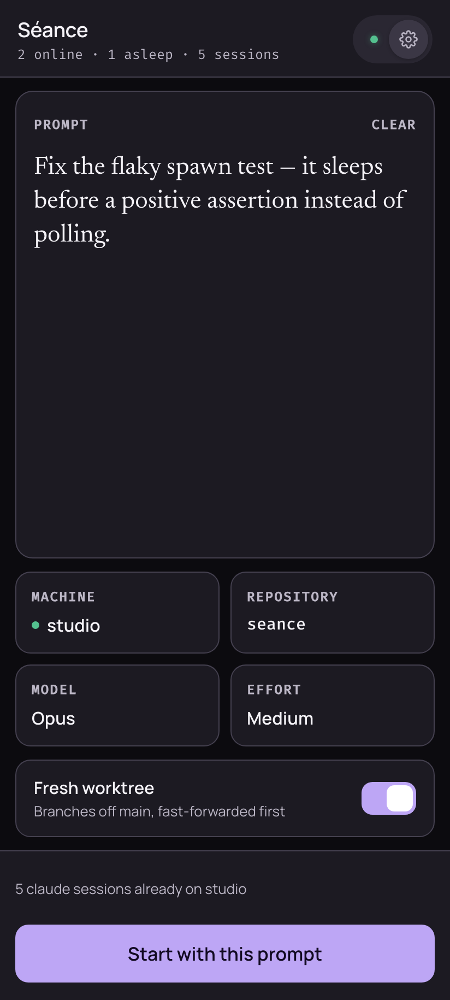
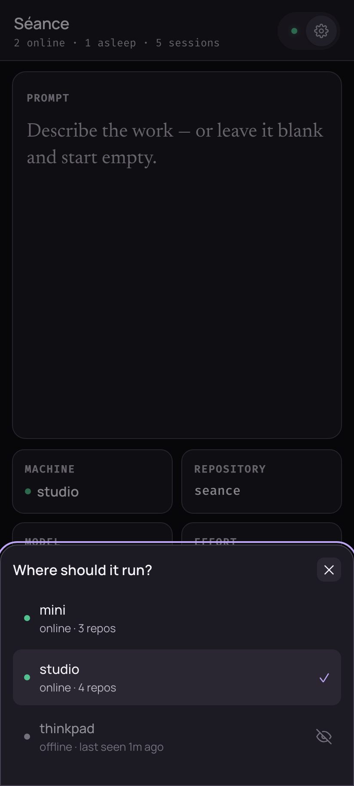
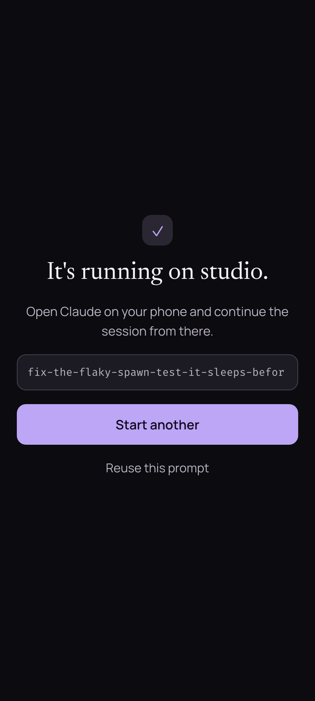

# Séance

Spawn new Claude Code sessions on any of your machines, from your phone.

[Setup](#setup) · [Usage](#usage) · [Docs](#docs)

<p align="center">
  
</p>

- **Starts sessions — doesn't just continue them.** Claude Code Remote Control
  resumes what already exists; Séance creates.
- **Every machine you own, with no pairing step.** macOS, Linux, WSL: a daemon
  holding the right token and key simply appears in the app.
- **A fresh worktree per session, by default.** Branched off `origin/<default>`,
  so a spawn neither inherits nor disturbs what you're in the middle of.
- **The relay is blind.** It routes ciphertext; the pre-shared key never leaves your
  own devices.
- **Free to run.** A Worker and a SQLite-backed Durable Object for the relay, a
  static-assets Worker for the app — all inside Cloudflare's free tier.
- **Daemons update themselves.** `git pull` and restart on one machine; the rest
  fetch, fast-forward, and restart on their own.

## Why

Claude Code Remote Control lets you _continue_ sessions from your phone, but
can't _start_ new ones on a machine remotely. Keeping a persistent "god"
session alive just to run a spawn script works, but it's fragile and
awkward. Séance replaces it with a per-machine daemon that's always ready.

## Security

The relay is a router, not a participant: every payload crossing it is sealed with a
pre-shared key you mint yourself, so Cloudflare stores and forwards ciphertext it
cannot read. The bearer token only gates access to the relay — the PSK is the actual
trust boundary, and it belongs in a platform key store rather than a file
([docs/psk.md](docs/psk.md)). On the machine, spawns exec argv arrays — the one
shell string is the tmux command line, where every wire-supplied value is
shell-quoted and the prompt travels by temp file, never argv — repos resolve by
name against a cached scan set rather than by path, and
prompt text is never written to the log. DESIGN.md carries the full threat model,
including what this deliberately does not defend against.

## How it fits together

| Component | Where it runs                                                            | What it does                                                                                                                                                                                            |
| --------- | ------------------------------------------------------------------------ | ------------------------------------------------------------------------------------------------------------------------------------------------------------------------------------------------------- |
| `relay/`  | Cloudflare Worker + Durable Object                                       | Routes opaque encrypted blobs phone↔daemon, persists the machine registry (presence = discovery) and the scheduler's sealed queue                                                                       |
| `daemon/` | Each dev machine (Bun; launchd on macOS, systemd user unit on Linux/WSL) | Holds WebSocket to relay, scans repo roots, spawns `claude` in a named tmux session, reports load and quota every 30s and keeps its history; `seanced mcp` serves the same reach to a local Claude Code |
| `pwa/`    | Cloudflare Worker (static assets)                                        | Spawn form, machine and repo pickers, spawn verdicts, per-machine counts of running sessions; a Machines screen with load, quota and history                                                            |

See [DESIGN.md](DESIGN.md) for the full architecture and every decision with
its rationale.

## Setup

Everything runs from one dev machine — which can also be the first daemon
machine. There is no chicken-and-egg: the two secrets are minted by you before
anything exists, and the only other shared value (the relay URL) is _produced_
by step 2 and consumed by steps 3 and 4.

Prerequisites: [Bun](https://bun.sh), a Cloudflare account, and this repo cloned with
`bun install` run at the root. The relay is one Worker plus one SQLite-backed Durable
Object, so it fits the free tier — no paid plan needed. Each daemon machine (macOS,
Linux, or WSL) additionally needs `tmux`, `git`, and `claude` on PATH. Linux machines
need systemd for `seanced install` — a standard Debian/Ubuntu box, VM, or LXC
container (unprivileged is fine) qualifies; without systemd, run `seanced` under your
own supervisor. **On WSL, enable systemd before anything else**: `systemd=true` under
`[boot]` in `/etc/wsl.conf`, which takes a `wsl.exe --shutdown` to apply and kills
every session on the box ([docs/platform-notes.md](docs/platform-notes.md)).

### 1. Mint the shared secrets

```sh
openssl rand -base64 32 | tr '+/' '-_' | tr -d '='   # bearer token
openssl rand -base64 32                               # PSK
```

Keep both in a password manager — every daemon and the phone get the same two
values. The bearer token must be base64url-safe because the app sends it as a
query parameter: a `+` decodes to a space and you get a silent 401 instead of
an error. The PSK is the actual trust boundary; the relay never sees it.

### 2. Deploy the relay

```sh
cd relay
bun run wrangler login                     # once
bun run wrangler secret put BEARER_TOKEN   # paste the bearer token
bun run deploy                             # prints https://seance-relay.<subdomain>.workers.dev
```

This first deploy is by hand; afterwards CI redeploys the relay on every push to
`main` that touches it, which needs a `CLOUDFLARE_API_TOKEN` repository secret and a
`CLOUDFLARE_ACCOUNT_ID` repository variable. The bearer token stays a Worker secret
and a CI deploy leaves it alone — as does `SCHEDULER_LEADERS`, the second secret,
set in step 4 once your machines have ids. Until it is set no machine leads the
scheduler, so **Auto** queues the task and it waits there until one does (no
preview, no placement); `seanced spawn --now` doesn't need it.

Note the `<subdomain>` in the printed URL — steps 3 and 4 derive their URLs
from it.

The first deploy also mints the `workers.dev` hostname, which needs a few
minutes to route and get a certificate. Until it does, requests fail the TLS
handshake or return a 404 with body `error code: 1042` — propagation, not a
broken deploy. The edge caches those errors, so re-check with a cache-buster
(`curl -sI '<url>/?x=1'`) rather than the path you already probed.

### 3. Deploy the app

`VITE_RELAY_URL` is required: it pins the CSP's `connect-src` to your relay, so
a build without it fails rather than shipping a page that cannot connect. It
also means pointing the app at a different relay later requires a rebuild, not
just a settings edit.

```sh
cd pwa
VITE_RELAY_URL=wss://seance-relay.<subdomain>.workers.dev/app bun run deploy
```

Or put it in a gitignored `pwa/.env` (see `.env.example`) and just
`bun run deploy`. This first deploy is by hand; afterwards CI redeploys the app on
every push to `main` that touches it, which needs the same value as a `VITE_RELAY_URL`
repository variable on top of step 2's secret and variable. This hostname is new
too — the step 2 propagation note applies again.

### 4. Install seanced on each machine

Distribution is the git checkout itself: the service runs
`bun <checkout>/daemon/src/main.ts`, so updating is `git pull` + restart.

```sh
git clone <this repo> && cd seance && bun install
bun daemon/src/main.ts init      # writes the ~/.config/seance/config.json skeleton
```

The CLI runs the same way, and to spare the typing:

```sh
bun daemon/src/main.ts link      # symlinks `seanced` into a dir on your PATH
```

The link is a plain symlink to `main.ts` (executable, `bun` shebang), so it
tracks `git pull` and source edits with nothing to re-run. It prefers
`~/.local/bin`, or takes a dir explicitly (`link <dir>`); `seanced unlink`
removes it, as does `uninstall`. A shell alias (`alias seanced='bun
<checkout>/daemon/src/main.ts'`) works too. `doctor` and `install` warn when
the name doesn't resolve — or resolves into a different checkout, which
`link` repoints — though they can't see an alias.

Edit `~/.config/seance/config.json`:

- `relayUrl` — `wss://seance-relay.<subdomain>.workers.dev/daemon` (must end
  in `/daemon`)
- `bearerToken` — from step 1
- `psk` — from step 1, or leave it empty and run `seanced psk-import` to keep the key
  in the platform store instead (macOS login keychain / WSL DPAPI blob / Linux
  TPM-sealed blob), which is where it belongs — see [docs/psk.md](docs/psk.md). Linux
  without a usable TPM has no such store; there the PSK stays in `config.json`, which
  `init` creates 0600. On systemd ≥ 256 the sealed blob is instead sealed once as root
  and delivered to the unit by PID 1, which `psk-import` can't do — docs/psk.md has
  that runbook.
- `repoRoots` — directories to scan for repos. Only these are scanned, so if you use
  exclaves (below) the roots must cover their trees for the clones there to appear.
- `machineTag` — optional short tag naming this box, suffixed onto the session name
  Claude Code registers, so the Claude UIs read `fix-the-thing (thad)`. The tmux window
  name stays bare — locally the machine is never in question. Leave it empty for
  unsuffixed names.
- `reap` — optional: `{ "intervalHours": 24, "minAgeDays": 4 }` runs `seanced reap`
  from the daemon every day, with its report in the log. Without `intervalHours` the
  schedule is off (the default); `minAgeDays` also sets the CLI's age gate.
- `quota` — optional: `{ "staleAfterMinutes": 10 }` (the default) is how old an
  account's cached quota may get before the daemon refreshes it with `claude -p /usage`.
  Values under 1 are refused: Claude Code debounces `/usage` for 60 s anyway.

Optional: `~/.exclaves` lists extra Claude Code accounts on the box, one name per line.
Each name is a tree at `~/<name>` whose sessions use the config dir `~/.claude-<name>`;
`default` (`~`, `~/.claude`) is implied and never listed. A clone's location decides which
account a spawn there runs under. From each exclave's `.claude.json` the daemon reads the
account ids and Claude Code's cached usage figures — never a token or the email — and
reports them, sealed, alongside load.

A running daemon watches this file and reloads within a second of a save, so
edits need no restart — including ones made by a Claude Code session on the
box. A bad edit is refused with the reason in the log and the previous config
keeps running, so the machine never drops offline over a typo. Only a code
change still needs `seanced restart`. A repo added _inside_ an existing root
needs nothing at all — the hourly rescan, or the app's refresh, picks it up.

```sh
bun daemon/src/main.ts doctor    # preflight: config, tmux/git/claude, relay reachability
bun daemon/src/main.ts install   # macOS: launchd agent (RunAtLoad + KeepAlive)
                                 # Linux/WSL: systemd user unit + linger (+ a Windows logon task on WSL)
```

On systemd ≥ 256 with the PSK in a TPM-sealed blob the daemon needs a root-owned unit
instead, so PID 1 can unseal the key and hand it over —
`sudo --preserve-env=PATH "$(command -v seanced)" install --system`, details in
[docs/psk.md](docs/psk.md) and [docs/platform-notes.md](docs/platform-notes.md).

Both platforms have sharp edges worth knowing about — linger on a headless Linux
box, the WSL logon pin task, and what happens while no Windows user is logged in —
collected in [docs/platform-notes.md](docs/platform-notes.md).

`doctor` prints a PSK fingerprint — compare it across machines to confirm they
all hold the same key. (Not on a box whose key is delivered to its unit by
systemd: nothing outside the unit can read it, so the fingerprint is in the
daemon's log instead.) A daemon with the right token and PSK simply appears in
the app; there is no pairing step.

**Let it lead the scheduler.** The relay nominates a scheduler leader — the daemon
that runs **Auto** — only from an allowlist: `SCHEDULER_LEADERS`, comma-separated
device ids, a Worker secret like the bearer token. Without it anyone holding the
bearer token could mint an id of their own and hold the role. Read the id off
`seanced doctor` (the `deviceId` line under `state`), then from `relay/`:

```sh
bun run wrangler secret put SCHEDULER_LEADERS   # paste every leader's id, comma-separated
```

It replaces the whole value, so paste the ids already on it too. Unset or empty, no
machine leads. List the machines that are usually awake; the role moves between
them as they come and go. Putting a secret rolls a new relay version, so every
daemon and app drops and reconnects once.

Every machine on that list also needs [`gh`](https://cli.github.com) on the `PATH` that
`seanced install` captured, and `gh auth login` run as the service's user (under
`--system`, that user), so the leader can read each task's PR status from GitHub: the
queue card's coloured chip, and a merged PR settling its task. On a Linux service with no
keyring or D-Bus session, `gh` must hold its token in `hosts.yml`
(`gh auth login --insecure-storage`), or the unit must carry `GH_TOKEN`; otherwise `gh`
reads as not logged in. Without `gh`, PR status does not show, the leader logs one
`pr-status:` warning, and nothing else breaks.

### 5. Set up the phone

Open `https://seance-pwa.<subdomain>.workers.dev`, add it to your home screen,
and in first-run setup enter the relay URL
(`wss://seance-relay.<subdomain>.workers.dev/app`), the bearer token, and the
PSK. Machines appear as their daemons register.

### 6. Optional: give a local Claude Code the same reach

On any machine that runs `seanced`:

```sh
seanced mcp install    # registers the MCP server with Claude Code (user scope)
```

Claude Code sessions on that machine can then reach every other machine through the
relay — see [From another Claude Code session](#from-another-claude-code-session).
`seanced mcp uninstall` removes it; `seanced doctor` reports whether it is
registered.

The entry records bun by its PATH name, so upgrading bun doesn't break it. A
user-scope entry lives in one Claude config directory, so `mcp install` registers
it in every exclave's (`~/.claude`, plus `~/.claude-<name>` for each name in
`~/.exclaves`) and in the shell's own `CLAUDE_CONFIG_DIR` when no exclave owns it.
An exclave whose config directory doesn't exist yet is skipped: add an exclave
later and re-run it. A task that settles on its session's own done report
(`until: "reported"`) needs it in the exclave the session runs in, since the session
reports through this server's `report_task_done` tool, which must be allowed there
(`mcp__seance__report_task_done` in that exclave's permissions): a call stopped at a
permission prompt reports nothing, and the task then waits for **Mark done**.

### 7. Optional: spawn from Raycast (macOS)

On a Mac with [Raycast](https://raycast.com) installed:

```sh
seanced raycast install    # builds this checkout's extension and imports it
```

Séance then appears in Raycast as **Spawn Session** — a form that reaches every
paired machine, one hotkey away. It reads this machine's `config.json` and the
PSK from the login keychain, so there is no secret to enter and nothing to
configure; Raycast's extension preferences hold only which machine, model and
effort to preselect.

The install is a local one — the extension is deliberately never published to the
Raycast Store — so nothing updates it on its own: **re-run it after a `git
pull`**, which `seanced doctor` reminds you of once the sources are newer than
the imported copy. `seanced raycast uninstall` removes the import and the build
artifacts; Raycast keeps listing the extension until you also remove it in
**Manage Extensions** (⌘⇧E), which no command can do for you.

### 8. Optional: Claude Code mods — `/rename` and session reports

```sh
seanced mod install    # installs this checkout's Claude Code mods (user scope, every exclave)
```

After a `/rename` in any Claude session in tmux — spawned or started by hand —
the remote-control name keeps this machine's ` (machineTag)` suffix (added when
you leave it out) and the tmux window takes the name without it, so
`/rename fix-auth` and `/rename fix-auth (thad)` both name the session
`fix-auth (thad)` and the window `fix-auth`. The daemon puts the tag in tmux's
global environment when it starts, so a shell opened before that (or before a
tag change) needs a new window. The mod is read in
place from the checkout, so a `git pull` reaches new sessions with nothing re-run
(running ones on `/reload-plugins`). `seanced mod uninstall` removes it;
`seanced doctor` reports whether it is installed from this checkout. Like
`mcp install`, it reaches every Claude config directory: plugins are per config
directory, so install, uninstall and doctor run once per exclave (`~/.claude`
plus each `~/.claude-<name>` listed in `~/.exclaves`), skipping any not set up yet.
An exclave created later needs `seanced mod install` run again.

The same command installs **session-events**. It tells this machine's daemon what
each session is doing (busy, idle, waiting on you, ended) and the PR it opened, which
is what the scheduler reads. Quota no longer comes from it: the daemon refreshes each
signed-in account's own cached reading with a `claude -p /usage` run once it is ten
minutes old, checking every minute and whenever a session there reports. It runs this
checkout's `daemon/src/main.ts session-event` with `bun` from PATH, so it needs no
`seanced link`. A session started outside tmux reports nothing.

## Usage

### From the phone

Type what the session should do — or leave the prompt blank to start an empty one —
then pick where it runs. Tiles open pickers: **machine**, **account**, **repository**,
**model** (Fable / Opus / Sonnet / Haiku), and **effort** (Low through Max), plus the
authoring ones below. **Fresh worktree** is on by default; switching it off runs the
session in the repo as it stands. Then queue it — or, from the chevron beside **Queue**,
**Start now**, which queues it and asks the scheduler to place it at once, past its
concurrency caps (shown only while the scheduler's leader supports it).

Every spawn from the phone is a queued task: the app never starts a session on a machine
itself. The verdict names the task and follows it until it is running, then you continue
the session in the Claude app like any other. The header counts sessions across every
machine (`2 online · 1 asleep · 3 sessions`), and the footer says who places the task —
the scheduler, or the machine you pinned.

A machine you have retired keeps its place in the picker with a stale last-seen —
the relay never expires an entry. The bin on an offline row deletes it there, so it
disappears on every device you use the app from, and returns only if that machine's
daemon connects again. `seanced uninstall` deletes it for you on the way out; under
`--system` it can't (as root it would read the wrong user's config) and says so.

There is no title field: the daemon names the tmux window after the prompt.

The machine's repo list comes from its daemon's last scan. **↻ Rescan** sits on that
machine's row in the Machine picker (offline machines can't answer it, and one rescan runs
at a time); it refreshes the list and the row shows when it last scanned.

The **Machine** and **Account** pickers each start on **Auto**, which lets the scheduler
choose; picking a machine or an account pins the task to it. The repository picker lists
repos by origin, across every machine that has a clone (narrowed to the picked machine and
account), and with both pickers on Auto a placement preview under the tiles says where it
would start and why each other machine lost. **Queue** (or **Queue on <machine>**) puts the
task in the relay's queue, and the queued verdict
shows the decision behind it, and why it waits while it does. With no scheduler leading
(no machine on the relay's `SCHEDULER_LEADERS` is connected — step 4), or one that
can't be verified (its registry entry doesn't open with your key), the task still
queues and waits there until one does; only the placement preview needs a leader.
Queuing is greyed only when the app isn't connected to the relay. A pinned task waits for
its machine or account when it is offline or over a limit, and says why; one still waiting
after 30 days fails, so a machine back later never runs a month-old prompt. Pinning an
account needs a leader that supports it, and says so otherwise. The **Queue screen** (a column on
desktop, in the header menu on a phone) shows everything queued: what needs you, what
is running or waiting, and what finished, with **Cancel** and **Mark done** (each takes
a second tap when it would end a running session), and **Pause** / **Resume**. The app
pauses the whole queue only; a hold on one account shows with its own **Resume**, but
no client sets one yet. `seanced spawn --now` starts a session directly on a machine,
with or without a scheduler.

Upgrading into the queue: until the machine leading the scheduler runs a build with
it, tasks an updated app or `seanced mcp` queues sit unrun, and an older app's
`auto` is refused by an updated leader. Update the leader-capable machines first.

**Machines** (a column on desktop, in the header menu on a phone) shows every machine
with its exclaves and accounts, current CPU and memory pressure, the newest quota
reading per account, the build its daemon runs, and history charts drawn from each
daemon's own store — an asleep machine's history waits until it wakes. Its header
names who leads the scheduler and under which term, or says no machine does; the
leader's card carries a **Scheduler** badge, or **Unverified** while its claim to lead
doesn't check out with your key.

<p align="center">
  
  
</p>

### From the machine

```sh
seanced spawn seance -t "flaky test" -p "fix the flaky spawn test"
#   task 3f2a…: queued — the scheduler picks the machine; needs the relay, and a PSK this shell or its daemon holds
seanced spawn --machine here seance -p "fix the flaky spawn test"
#   pinned to this machine: it waits for a slot here rather than going elsewhere
seanced spawn --account work --not here seance -p "rerun the slow suite"
#   pinned to an account (alias, email or id) and kept off this machine
seanced spawn --now seance -t "flaky test" -p "fix the flaky spawn test"
#   spawned 'flaky test' (~/repos/seance/.claude/worktrees/flaky-test)
seanced spawn --now seance --here   # run in the checkout as it stands, no worktree
seanced continue 3f2a…        # resume a failed (e.g. OOM-killed) or cancelled task's conversation in its worktree, as a new task (--prompt <text> to add a note)
seanced sessions              # running claude windows: id, window, repo, path
seanced despawn %12           # end one by id: asks claude to exit, kills the pane after ~5s (--force: now)
seanced reap --dry-run        # what clean-up would remove: worktrees, branches, dead windows
seanced status                # this machine: service, relay, repo count, running vs on-disk sha
seanced doctor                # preflight config, binaries, roots, relay, service
seanced help                  # every command
```

With `--now`, `<repo>` is a _name_, matched exactly against the cached scan set and never
joined as a path — so it is whatever `seanced scan` calls the repo (a bare basename, or
`parent/base` when two collide); a queued spawn resolves a clone name or origin across the
fleet, as below. Bare words after it become the prompt, which makes
`-p` optional: `seanced spawn seance fix the flaky test` works.

`seanced continue` queues a new task like a spawn does, so the scheduler tracks it. Running
`claude --continue` by hand in the worktree works too, but séance does not see that session.

A spawn queues for the scheduler, as the app's and MCP's do: `<repo>` is a clone name or
origin from any machine in the fleet, and the task waits in the relay's queue until a leader
places it. It needs the relay: it reads the PSK itself, or on a box where only the daemon can
(below) asks the running daemon to enqueue for it. The app's queue shows where it lands.
`--now` is the direct path: it spawns on this machine right away, with no relay, key, leader or
daemon, for a fleet nobody leads, a keyless box or debugging over SSH; it takes no pin flags.
(`--auto`, the old spelling of the default, is still accepted and does nothing.)

Worktree mode, the default, puts the session in `.claude/worktrees/<slug>` on a
`worktree-<slug>` branch. The daemon fetches `origin/<default>` first (5s at most),
then Claude Code branches from it, so what your checkout is on, and whether it is
clean, changes nothing and is left untouched. If origin can't be reached the spawn
still goes ahead on the last-fetched `origin/<default>`, and its reply carries a note
saying so and how old that fetch is. (A machine whose
`settings.json` sets `worktree.baseRef` to `"head"` branches from its checkout
instead; that is claude's setting, not séance's.) `--here` skips the worktree and runs
in the checkout you already have, as it is — the daemon never pulls it, but when it is
on the default branch and behind origin, the reply notes by how many commits.

`despawn` closes the window only. A worktree session is told to keep its worktree on
the way out, so the work stays where it was; cleaning up worktrees and branches is
`reap`'s job.

`reap` cleans up after sessions across every repo the daemon scans. It removes a
linked worktree only when no tmux pane is inside it, it is clean, its branch is merged
(including squash-merged — checked locally, no `gh`), and nothing has touched it for
four days (`--min-age-days` to change). It deletes merged branches, closes séance windows
that are dead or sitting on claude's "keep or remove this worktree?" prompt, and
reports what it left: dirty worktrees, branches and worktrees whose upstream is gone but
which hold unpushed commits, worktrees on a never-pushed branch, detached worktrees with
commits on no branch, a count of worktrees on a branch whose upstream is still live, and live sessions with the id `despawn` takes. Where git runs
`core.fsmonitor=true` daemons (macOS), it also stops every one with no tmux pane in its
checkout and an hour unused, and any on a directory gone or no longer a repo, reporting
the memory freed; git starts a new one when a repo next needs it. Every deleted branch
is in the audit log with its sha, so `git branch <name> <sha>` brings it back. It acts
by default; run `--dry-run` first.

`status` reports the machine you run it on — including the sha the daemon is running
versus the one on disk, which is how you spot a `git pull` that still needs a
`restart`. The cross-machine view is the app, or `list_machines` over MCP.

### From another Claude Code session

With `seanced mcp install` done (step 6), a local Claude Code can list machines,
query running sessions, and spawn and end sessions on other machines through the relay:
`list_machines`, `get_sessions`, `spawn_session`, `despawn_session`, `get_queue`, `cancel_task`, `continue_task` (resume a failed or cancelled task's session in its worktree, as a new task), `queue_batch` (several tasks queued as one group, ordered only by the dependencies between them) and, for a session settling its own task, `report_task_done`. The server reads the daemon's own
config and speaks to the relay exactly like the phone does.

`spawn_session` always queues the task in the relay, as the app's **auto** does: it answers
at once with the task id and "queued", and `get_queue` lists
the scheduler's recent tasks with where each landed and why, and any pauses in force.
`repo` is a repo name from `list_machines` (or its origin, when the name means different
repos on different machines). `machine` is optional: a machine name or deviceId pins the task
there (`"auto"`, or leaving it out, pins nothing; it is the same as `pin.machine`, and giving
both is refused). `pin: { machine?, account? }` restricts where it may run — the
task waits for a slot there rather than going elsewhere — and `repo` is then the name as the
pinned machine (or the account's clones) list it; `account` is an alias, an email or an
accountId, and the answer names the account it resolved to. `avoid: [machine, …]` (at most 4)
keeps it off machines. An unknown or ambiguous machine or account, an account no machine reports
signed in, or a machine whose daemon reports no exclaves is refused; an account pin or `avoid`
also needs a scheduler leader on a build that routes on them. The queue is the relay's, so a task waiting for capacity
survives leadership moving — every relay deploy and daemon self-update — and so does one
queued while no scheduler leads: the next leader runs it.
On a box where only the daemon can read the key (below), a spawn goes through the daemon.

On a Linux box whose PSK is TPM-sealed and delivered only to the daemon's system unit,
the server can't read the key — so it asks the running daemon to make those requests
for it, over the same local socket, and the key never leaves the daemon. Every tool,
`spawn_session`, `get_queue` and `cancel_task` included, still works for every machine, with the same
registration; a server that started before the daemon was updated keeps the old "needs this machine's own
key" answer for spawns until its Claude session restarts. `seanced doctor` says which
path MCP takes from your shell. Only such a daemon brokers: wherever the server can
read the key itself, the daemon runs no broker, so nothing gains fleet reach without
the key. See [docs/psk.md](docs/psk.md#mcp-on-a-credential-delivered-box).

Naming _this_ machine in `get_sessions` or `despawn_session` skips the relay entirely: the request goes straight to the
local daemon over a unix socket in the state directory, so it costs no round trip and works with the relay down.
A spawn never takes it, since it is a queued task. It is the same daemon,
backend and audit trail either way — the log says `origin=local` instead of
`origin=relay`, and `seanced status` and `doctor` report whether the socket is up.
If a remote machine shares this one's name, local wins; reach the remote one by its
`deviceId`.

Treat `spawn_session` and `despawn_session` like the remotes they are: leave them
behind Claude Code's per-tool approval rather than allowlisting them.

## Updating

```sh
git pull && bun daemon/src/main.ts restart    # daemon, on one machine
```

Daemons self-propagate: the restarted daemon notices its version changed and
announces it over the relay, and every other machine fetches, fast-forwards
its default branch, runs `bun install --frozen-lockfile`, and restarts itself.
A machine that was asleep or offline catches up on its next reconnect. One
update is not transparent: the first daemon with a signed identity (October 2026) mints a key and a new `deviceId` for the machine, so the app lists the
old id as an offline stranger — forget it there; `seanced status` shows the new
one. A machine whose id changes — that update, a reinstall, a lost `state.json` —
also drops off `SCHEDULER_LEADERS` until you put its new id there (step 4). A
checkout that is dirty, on another branch, or has local commits is skipped —
never forced — and reports why; `seanced status` on that machine shows its version
and its last update outcome. The relay and the app deploy themselves from CI on a
push to `main` that touches them (`Deploy` in Actions also runs on demand, per
component), so deploying either by hand would race that.

The relay that brought in the leader allowlist (October 2026) nominates nobody
until `SCHEDULER_LEADERS` is set, so put the secret (step 4) **before** that
deploy lands; set after, **Auto** still queues in between but no leader runs the
queue until the secret is set, and nothing else is affected.

The Raycast extension does not self-propagate: it is a built copy, so a machine
that has it needs `seanced raycast install` re-run after the pull. `seanced
doctor` flags one that is out of date.

Service definitions already on disk lag behind the code that writes them, and
machines installed before certain fixes need a one-time catch-up — both in
[docs/platform-notes.md](docs/platform-notes.md). `seanced doctor` flags a machine
that still needs it.

## Docs

- [docs/psk.md](docs/psk.md) — where the pre-shared key lives on each platform, how to
  import it without it touching argv or shell history, and what the TPM path does and
  does not protect.
- [docs/platform-notes.md](docs/platform-notes.md) — WSL and Linux service specifics,
  plus the one-time catch-up for older installs.
- [docs/development.md](docs/development.md) — running the relay and app locally, and
  the test suite.

This is a personal project shared publicly rather than one looking for contributors:
issues and observations are welcome, but the roadmap is whatever I happen to need
next.

## License

[MIT](LICENSE)
