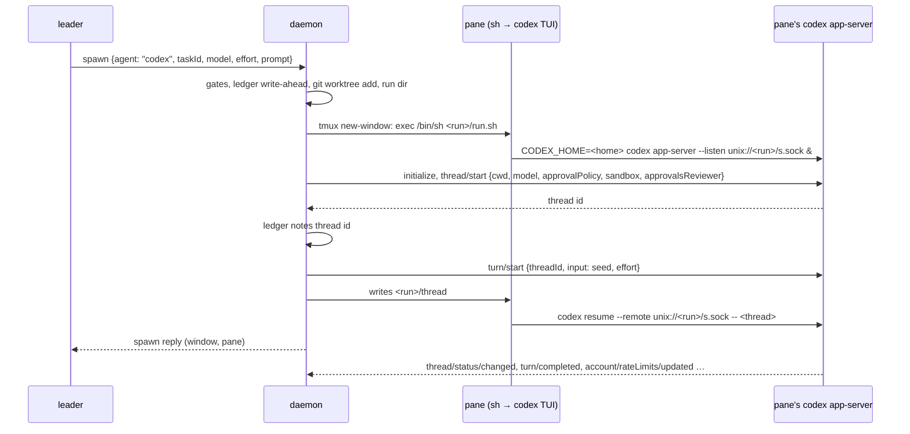

# Codex as a first-class account — design

**Status: phase 1 (items 1, 2, 3), phase 2 items 4, 6 and 8 and item 5 built, the rest design.** Item 8 (2026-11-24),
the clients (the PWA's picker grouped by agent, effort per agent, the agent badge; MCP's and the CLI's `agent`; the
gates and the broker leg's sentinel), is in DESIGN.md: Scheduler, "Codex tasks", "Clients"; Wire protocol's
compatibility list; and the threat model's "The task field `agent`". Item 6 (2026-11-24),
the Codex launch, is in DESIGN.md: Daemon, "Codex sessions"; and the threat model's "A Codex pane's server socket",
"What the daemon sends a Codex server, and keeps" and "A Codex launch's thread id" (this doc's threat-model items 4, 5
and 10, and 12's spawn and despawn lines). Item 4 (2026-11-24), the task
field `agent` and its routing, is in DESIGN.md: Scheduler, "Codex tasks"; Wire protocol's compatibility list; and the
threat model's "The task field `agent`" (this doc's threat-model item 9). Item 1 (2026-11-23), the daemon's side of the account — the
`codex` config block, the home and its generated `config.toml`, the version floor, the probe, `seance codex login |
logout | status`, `MachineInfo.logins` and `MachineStatus.lq`/`lx`/`lu`/`lb` — is recorded in DESIGN.md: Daemon, "Codex
login"; Presence & identity (the status fields and their trim); and the threat model's "A second credential store, never
opened", "Identity, quota and login health come over Codex's API", "A second binary" and the `seance codex` verbs (this
doc's threat-model items 1–3 and 12's login line). Item 5, the driver seam, is in DESIGN.md, Daemon, "Agent drivers".
Item 2 (2026-11-24), the fleet's readers of a login, is in DESIGN.md, Daemon, "Codex login", "Fleet readers"; Scheduler,
"Auth alerts" and "Fleet quota record"; Archivist, "Metrics"; and the threat model's "The fleet reads an agent login
as it reads an exclave". Item 3 (2026-11-24), the PWA's view of a login, is in DESIGN.md, PWA, "An agent login is an
account like a Claude one", and Account records (only a twin of the same kind is tagged). Where this doc and DESIGN.md differ on those, DESIGN.md is the record.
Written 2026-11-23 from docs/agents.md (the scoping, both Codex spikes
of 2026-11-19 on 0.166.0, the owner's decisions of 2026-11-19) and a read of the code at `923bb32`. API names were
checked against the app-server schema that **codex-cli 0.170.0** generates. Spikes S2, S3 and S6 ran on macOS against
0.170.0, and S8's Linux half ran on Thad (an LXC, 0.166.0), all on 2026-11-23 ("Spikes"). The owner decided every
question this doc raised the same day ("Decisions"); this doc's own choices are marked **Decided: X, because Y**. What
remains are checks to run before the phase that needs each, none of which decides anything.

## Goal

A ChatGPT sign-in on a machine is an account the way a Claude login is:

- **named** by an alias any client shows (the `account:` record), else its email;
- **measured**: its 5-hour and weekly windows on the account card, in routing, in the archive;
- **watched**: its login health on the Machines card, a push when it lapses;
- **governed**: closed and reopened (the account hold), pinned to, avoided by the quota line, spilling into credits past
  it as a Claude account spills into extra usage;
- **used**: a task picks a GPT model beside Opus, and the leader places it on a machine whose Codex login has headroom,
  in a tmux pane like any other session.

Not in this design's V1: choosing the agent automatically (a policy question, docs/agents.md "Order" step 3), more than
one Codex account per machine, and `agy` (the seams below are agent-neutral, so it is a second driver, not a second
design).

## The shape in one paragraph

The ChatGPT login lives in one Codex home the daemon owns (`stateDir()/codex/home/`), signed in once per machine by the
owner and shared by every Codex process Séance runs there, as an exclave's config dir is shared by its Claude sessions.
Identity, quota and login health come over the app-server API from a short-lived probe, never from the credential file,
and reach the wire as a new `MachineInfo.logins` list beside `exclaves` with its own status fields. A task carries
`agent: "codex"` behind a dep sentinel and a capability. Its session is a tmux pane that hosts **its own**
`codex app-server` on a socket in a run dir the daemon made, with the daemon as that server's client and the TUI joining
as the pane's view once the first turn is under way. The daemon starts the thread (so it knows the thread id before
anything runs), sends the seed as `turn/start` input (never argv), and reads the session's state from the server's
notifications. Hooks, tools and MCP servers are the pane server's children, so binding by peer pid holds as it does for
Claude. Escalations out of the sandbox go to Codex's reviewing agent, never to a person who is not there.

## Decisions

From the owner, 2026-11-19 (docs/agents.md):

- **Native panes first**; a sidecar server the daemon owns only if panes cannot work, and a dying sidecar must never
  take the daemon down. This design keeps the pane.
- **Codex first, then `agy`.**
- **The agent stays explicit** until Codex has a track record on these repos.
- **One `agy` account per machine for V1**, hung off the machine as an agent login, an exclave supplying only the tree.

From the owner, 2026-11-23, on this doc's questions:

- **O1. One Codex login per machine** (D1).
- **O2. Codex credits spill as Claude's extra usage does**: past the quota line, a task may run on credits while the
  account can spend them. The unit of Codex's amounts is settled at the first real spill; until then no amount is
  shown ("Credits and spill").
- **O3. Homes are like exclaves**: one home per login, every session on it (D4). A task always starts whether or not
  the home is paired with a phone; pairing never decides whether a session can start.
- **O4. Messages into a Codex session may arrive as user turns** (`turn/steer`, `turn/start`) in Séance's fixed
  wrappers, behind the same binding and rate limits as the inbox, with the standing instruction saying what a message
  is (phase 3).
- **O5. Unattended approvals go to Codex's reviewing agent** (D5), decided after spike S3.

This doc's:

- **D1. One Codex login per machine, hung off the machine.** _Decided, because_ the owner's `agy` decision rests on
  reasons that hold for Codex (an exclave is 1:1 with a Claude account only to isolate Claude accounts; exclave trees
  are clones of the same repos). `logins` is a list, so a second login later is additive. Confirmed by O1.
- **D2. The home is Séance's, not the owner's `~/.codex`.** _Decided, because_ the owner's home carries the owner's own
  config (their model, MCP servers and project trust would reach every task), runs the owner's auto-start daemon and its
  self-updater (0.171.0 from `~/.codex/packages` on the Mac while `PATH` had 0.170.0), and holds the owner's one
  remote-control slot. A separate sign-in is a separate refresh-token chain: neither logs the other out. Cost: one
  device-code sign-in per machine.
- **D3. A pane hosts its own server; the daemon is its client.** _Decided, because_ it is the one shape that answers
  both of docs/agents.md's risks and its four gaps at once: binding by peer pid holds (everything runs under the pane),
  the thread id comes from the daemon's own `thread/start` (no claimed id), the seed is data, and quota, identity and
  turn state come over a typed API. S2 and S3 showed it working on 0.170.0. Rejected shapes are listed at the end.
- **D4. One home per login, every session on it** (O3). A home limits only remote control (one remote-control server
  per home, docs/agents.md spike 2), never sessions: S3's server ran on a home beside the owner's own Codex daemon. So
  there is no pool, no symlinked credential, no per-machine Codex session cap of its own (machine pressure, quota and the
  fleet limit bound Codex sessions as they bound Claude's), and the phone reaches one session per machine at a time
  (phase 3).
- **D5. Approvals: `approvalPolicy: "on-request"`, `approvalsReviewer: "auto_review"`, `sandbox: "workspace-write"`**,
  the defaults of the machine's own `config.json` `codex` block, never a frame (O5). _Decided, because_ S3 showed an
  approval request waits until some client answers it and the daemon never does, so with the reviewer at `user` an
  unattended task stalls at its first escalation; S8 showed `.git` read-only and the network off under
  `workspace-write`, so every commit, push and `gh pr create` is an escalation; `auto_review` answered one in about 3 s
  with no client asked; and `never` would fail those commands outright, so no task could open a PR. The cost: a model,
  not a person, approves escalations. No autonomy level changes these (DESIGN.md, "Autonomy level").
- **D6. Phase 2 runs Codex tasks at `autonomy: "auto"` only.** _Decided, because_ in Codex's default mode a question is
  prose and reads as an idle turn end with no alert ("Questions read as idle"). Phase 3 opens `checkpoint`. Cheap to
  reverse.

## The account

### Where the login lives

```
stateDir()/codex/              0700, the daemon's own
  home/                        CODEX_HOME for every Codex process Séance runs on this machine
    auth.json, auth.lock       written and refreshed by Codex alone
    config.toml                generated (below)
    sessions/, state_5.sqlite  Codex's own: threads, the remote-control enrollment (phase 3)
  remote.json                  the daemon's: whether the home is paired (phase 3), 0600
```

- **One home, many processes.** Every pane's server, the probe and `seance codex login` run with this `CODEX_HOME`.
  Codex already serializes a refresh between processes on one home (it takes `auth.lock`, reloads the file first and
  skips when another process refreshed). The daemon never makes a copy or a link of `auth.json`: the first refresh of a
  copy logs every other copy out (`refresh_token_reused`, docs/agents.md spike 2).
- **`config.toml` is generated whole** at each daemon start, never edited: `cli_auth_credentials_store = "file"`, update
  checks off, `project_doc_fallback_filenames = ["CLAUDE.md"]` so Codex reads a repo's CLAUDE.md where a directory has
  no AGENTS.md (S9), `project_doc_max_bytes = 262144`, `[mcp_servers.seance]` resolved as `daemon/src/link.ts`
  resolves it for Claude (through `PATH`, never `process.execPath`), and no hooks. Approval, sandbox and reviewer go on each `thread/start` (D5); remote control is
  enabled per server over the API (phase 3), never by config: a `--listen` server starts with it `disabled` (S5, part).
- **A repo's instructions reach Codex whole.** _Decided: the 256 KiB cap, because_ Codex cuts project instructions at
  32 KiB by default (S9) and Claude Code reads a CLAUDE.md whole, so a longer file would silently lose its last rules
  to a Codex session alone. Where a directory has an AGENTS.md, Codex reads it instead of CLAUDE.md (S9); Séance
  leaves that to the repo, since an AGENTS.md is the repo's word to Codex, and a pointer one ("Read and follow
  CLAUDE.md", as the PengeFix repos have) was followed with a read at the turn's start (S9).
- **`config.json` gains a `codex` block**, the machine's own, parsed strictly like `adapters`: `approvalPolicy`
  (`untrusted`, `on-request`, `never`; default `on-request`), `sandbox` (`read-only`, `workspace-write`; default
  `workspace-write`; `danger-full-access` refused), `approvalsReviewer` (`user`, `auto_review`; default `auto_review`).
  No block, no Codex on the machine: no probe runs and `logins` is `[]`.
- **A version floor.** The daemon reads `codex --version` at each probe; below `CODEX_MIN_VERSION` (0.170.0, the
  version the spikes ran: 0.166.0's `account/read` has no `userId`) the login is reported with its version and never
  placed (`login_outdated`).
- **The owner's verbs** (`seance codex login | logout | status`, phase 3 adds `pair | unpair`) are shell acts in the
  one `COMMANDS` table (so a custodian round is denied them by its generated fence), audited under origin `cli`, never a
  frame, local-socket op, broker action, app op or MCP tool. `login` runs `codex login --device-auth` with
  `CODEX_HOME` set to the home, so it works over SSH; Codex prints the code, Séance prints nothing of it.

### Identity

- **The account id is `codex:<account>:<user>`**: `<account>` is `account/rateLimits/read`'s `accountId` (the backend's
  account, which is the workspace for a Business plan) and `<user>` is `account/read`'s `userId`, both read over the
  probe's API. A Business seat and a personal Plus plan of one person are two accounts with two quotas, so the workspace
  half is needed. On a Business login (`planType: "team"`) both halves were present and identical across two fresh
  processes (S1, part).
- **Either half null reads as unidentified**: the login shows on the Machines card, carries `accountId: null` and is
  never placed (`auth_missing`, below). _Decided: no fallback to the email, because_ an id that changes shape when a
  field appears would split one account in two in the fleet quota record, the holds and the archive.
- **Disjoint from Claude's ids by construction**: Claude's is `organizationUuid:accountUuid`, never prefixed. Every
  reader holds an account id only to `isAccountId` (a bounded non-empty string), so the `account:` record, its alias and
  rename, pins, holds, the fleet quota record and the archivist's account rows take a Codex account with **no change**.
  `knownAccounts` (`shared/src/account-record.ts`) reads `logins` beside `exclaves`, so `accountName` finds the email.
- **`accountStoreKey`'s HMAC input stays `oauth|` plus the id.** Its comment reserves the namespace for "another kind
  of account id"; _Decided: no new namespace, because_ the id names its own kind, so the inputs are already disjoint,
  and a namespace chosen by kind would make every caller know the kind of an id it holds only as a string. Codex's
  login is OAuth too.
- `email`, `planType` and `workspaceName` are display only, carried in the sealed blob as a Claude exclave's `email` and
  `seatTier` are.

### Quota

- **The source is `account/rateLimits/read`**, no model call, and a fresh process fetches it live (S6: about 0.5 s, and
  the 5-hour figure moved from 2% to 3% after the spike's own turns). Its windows map by `windowDurationMins`, not by
  position: 300 to `h`/`hr`, 10080 to `d`/`dr` (both seen in S6). A `rateLimitsByLimitId` bucket naming a
  `normalModelSlug` with a 10080-minute window joins `w` under that slug, so `windowAppliesTo` holds it to tasks on that
  model; the Business login in S6 had only the `codex` bucket, with no slug. Any other duration is dropped.
  `usedPercent` is an integer and `resetsAt` unix seconds (S6).
- **`s` stays `"cache"`.** _Decided, because_ a new `QuotaSource` would reach the fleet quota record, whose strict
  parser in an older daemon would then read the whole record as unreadable. The value means "the agent's own reading",
  which this is.
- **`ordinaryUsageAllowed: false`** (the backend's word that included usage is blocked; its schema says not to infer
  recovery from percentages) puts the login in `lb`, which routing filters.
- **Cadence, as the `/usage` refresh's.** A probe runs only for a reading older than `quota.staleAfterMinutes`, on a
  minute timer, never for a signed-out or expired login, and on the usage refresh's one process-wide lane, so a small
  LXC never carries a Claude refresh and a Codex probe at once. While a session runs, its server's
  `account/rateLimits/updated` notifications reach the daemon's connection after every model call (S3) and keep the
  reading fresh with no probe at all.
- **The probe** is a `codex app-server` child on stdio in the home: argv array, `exec.ts`'s bare `childEnv` plus
  `CODEX_HOME`, its own process group, `initialize`, `account/read` (`refreshToken: false`), `account/rateLimits/read`,
  then stdin closed — driven line by line on its own `Bun.spawn` rather than through `exec`, since the app-server
  exits at EOF without answering what is pending (checked at build, 0.170.0), and `exec` closes stdin up front; killed by group at 30 s, output capped at 64 KiB. Every answer goes through a parser that requires
  the fields it keeps (the two id halves, email, plan, workspace name, percents, reset times, the credit fields) and
  ignores any other: 0.170.0 already answers fields its own schema lacks (`workspaceRouting`, `rateLimitResetCredits`,
  `rateLimitUpsell`). Nothing it writes reaches a log; a failure warns once per streak with no excerpt (unlike the usage
  refresh, its output may carry account data).

### Credits and spill

- **The rule is Claude's** (O2): past the quota line a task may spill while the account can spend credits; a successor
  never spills; seats and `model_not_included` stay Claude's.
- **Can spend**: `credits.hasCredits` or `credits.unlimited`, and none of: `spendControlReached`, an `individualLimit`
  at 0% remaining, a `rateLimitReachedType` of `workspace_owner_credits_depleted`, `workspace_member_credits_depleted`,
  `workspace_owner_usage_limit_reached` or `workspace_member_usage_limit_reached`. `AgentLogin.credits` is set when
  `hasCredits` or `unlimited` is (the `extraUsageEnabled` of a login) and re-registers on change.
- **On the wire, `c` and never `cu`/`cl`.** `c` is `100 − individualLimit.remainingPercent` when a member limit is
  reported, else `0` while the account can spend and `100` once it cannot, so routing's `creditsSpent` reads it
  unchanged. `cu` and `cl` are USD cents; Codex's `balance`, `used` and `limit` are strings in a unit no response states.
  _Decided: no amount shown, because_ O2 leaves the unit to the first real spill: the account card's Credits bar notes
  available, a percent of the member limit, or spent. The Business login in S6 reported `hasCredits: false`, so it
  cannot spill today.

### Login health

- **From the same probe, never from the home's files.** The daemon opens no credential file, not even through
  a child: strictly less than Claude's auth health, which has to. `refreshToken` is never set, so Codex refreshes under
  its own rules (within 5 minutes of expiry, or 8 days after the last).
- **States, read from `account/rateLimits/read`'s answer**, since `account/read` answers `account: null` both signed
  out and with a login the backend refuses (S4):
  - **`ok`**: it answers, and both id halves are present (one missing is unidentified: "Identity").
  - **Signed out** (`authOk: false`): JSON-RPC error `-32600`, "authentication required", answered with no network
    call. A home with no `auth.json` and one Codex cannot parse answer alike (S4); `seance codex login` fixes both.
  - **Expired** (`lx`): error `-32603` whose message carries `401 Unauthorized`, the backend refusing the login (S4).
    The parser tests that one fixed text and keeps nothing of the message, which quotes the backend's response body,
    so a change of wording reads as unknown, never as signed in.
  - **Unknown** (`lu`): any other failure (another `-32603`: the network, the backend), a timeout, or no probe yet.
- Codex gives no refresh-token expiry, so there is no `expiring`. `codex login status` is no health check: it reported
  "Logged in" for the login S4's backend refused.
- **Alerts** reuse the leader's `authAlertStep` and its `SettingsRecord.authAlerts` entries for a login read from `lx`,
  under the key `login.codex` (built: DESIGN.md, Scheduler, "Auth alerts"). The push is the `auth` kind's, but its text
  is Codex's own ("A Codex login needs seance codex login."), chosen by the service worker from that fixed key:
  _corrected at build_, since the Claude text names `/login`, which does nothing for a Codex login.

### On the wire

```ts
/** A non-Claude agent's login on this machine (docs/codex.md, "The account"): one per agent in V1. */
export interface AgentLogin {
  readonly agent: "codex";
  /** `codex:<account>:<user>`; null when signed out or unidentified. Never the email. */
  readonly accountId: string | null;
  readonly email?: string; // display
  readonly plan?: string; // `planType`, display
  readonly workspace?: string; // `workspaceName`, display
  readonly authOk: boolean;
  /** The account can spend credits past its included usage ("Credits and spill"). */
  readonly credits?: true;
  /** The home is paired with a phone (phase 3); display only, never a routing input. */
  readonly paired?: true;
  readonly version?: string; // `codex --version`
}

interface MachineInfo {
  // …
  /** Absent from an older daemon (unknown); `[]` when none is configured. */
  readonly logins?: readonly AgentLogin[];
}

interface MachineStatus {
  // …
  /** Quota per login: `x` indexes `MachineInfo.logins`, never `exclaves`. */
  readonly lq?: readonly QuotaObservation[];
  /** Logins whose sign-in has lapsed (`lx`), not yet read or unreadable (`lu`), blocked by the backend (`lb`). */
  readonly lx?: readonly number[];
  readonly lu?: readonly number[];
  readonly lb?: readonly number[];
}
```

- **A list beside `exclaves`, never an entry in it.** An older leader would read a Codex entry as a Claude exclave and
  place Claude tasks on it, and `quota[].x`, `ax` and `sess` index that list.
- `lx`, `lu` and `lb` are never trimmed (as `ax`), disjoint, range-checked against the held blob's `logins` and
  refused past a small bound. `lq` is trimmed with quota detail, before any Claude quota entry. The status budget is
  measured at build time, as `status.test.ts` does for the exclaves.
- A change of identity, `authOk`, `credits`, `paired` or `version` re-registers, as a sign-in on a Claude exclave does.

### Routing a Codex task

A candidate is still a (machine, exclave) pair, because the exclave supplies the clone; for a Codex task the account is
the machine's Codex login instead of the exclave's Claude login (`accountOf(machine, exclave, agent)`).

| Reason                                                       | For a Codex task                                                                      |
| ------------------------------------------------------------ | ------------------------------------------------------------------------------------- |
| `agent_unsupported` (new)                                    | the machine does not advertise `CAPABILITIES.codex`, or the spec asks what V1 refuses |
| `login_absent` (new)                                         | `logins` is absent or holds no Codex login                                            |
| `login_outdated` (new)                                       | the login's `codex` is below `CODEX_MIN_VERSION`                                      |
| `auth_missing`, `auth_expired`                               | the login's `authOk`/`accountId`, `lx`; one code per candidate, as for Claude         |
| `login_blocked` (new)                                        | the login is in `lb`                                                                  |
| `quota_unknown`, `quota_over_line`, spill                    | as for Claude, on the login account's newest reading and `AgentLogin.credits`         |
| `paused`, `pin_mismatch`, `avoided`, traits, machine filters | unchanged: a hold, pin or close names a Codex account id as it names a Claude one     |
| `skill_absent`, `model_not_included`                         | not applied: the skill inventory, seats and gated models are Claude's                 |

- **Counting by account follows each task's own agent.** `accountInFlight` asks every in-flight task's agent for its
  account, so a running Codex task counts against the Codex account, never the exclave's Claude one. A Claude task's
  candidates never read `logins`, so its routing is unchanged.
- **One account on two machines is one account.** `newestQuotaByAccount` folds `lq` by `logins[x].accountId` beside the
  exclaves' quota; the fleet quota writer folds it the same way, and the archivist's quota series label it by its
  `account:` store key.
- **Estimates:** every Codex plan uses `unknownSeat` (capacity 1) until observed deltas say otherwise.
- All of a machine's exclaves share its login, so their account pressure ties and the existing tie order (device, then
  exclave in code-unit order) decides, reproducibly.

## The task

- **`TaskRequest.agent?: "codex"`**, absent meaning Claude. A parser takes `"claude"` and drops it, so no Claude record
  changes by a byte. `AGENT_KINDS` (`shared/src/tags.ts`) gains `codex`; `agent.kind` already reads from it.
- **`AGENT_DEP_SENTINEL = { task: "", after: "agent" }`**, appended by `taskRecordAtRest` whenever `agent` is set; the
  parser drops it only beside `agent` and nulls the spec over it without, exactly as `TAGS_DEP_SENTINEL`. An older leader
  holds a Codex record unreadable rather than re-seal it without the field and hand it to `claude`.
- **`SpawnRequest.agent?: "codex"`.** An older daemon would drop the field and start Claude, so the leader sends it only
  to a machine advertising `CAPABILITIES.codex` (the route filter), and the PWA's and CLI's direct spawns only to one.
- **`CAPABILITIES.codex`**: as a leader, parses, keeps and routes `TaskSpec.agent`; as a daemon, launches
  `agent: "codex"` and is placed on only while its `logins` holds a signed-in Codex login at or above the floor. Clients
  write `agent` only to a verified leader advertising it. One build does both halves.
- **Model and effort.** `model` stays a free bounded string; a Codex task's default is `DEFAULT_CODEX_MODEL` and the
  clients' list is a constant `CODEX_MODELS` in `shared/` beside the PWA's `MODELS`. _Decided: a constant, not each
  login's `model/list` in the blob, because_ one picker does not justify growing every register. Effort keeps Séance's
  `EFFORTS`; `max` beside `agent: "codex"` is refused (0.170.0 had no `max`; mapping it silently to `xhigh` would run
  something nobody asked for. 0.171.0 lists `max` on most models: lifting the refusal is a later choice, per model). The record always says `agent` explicitly; no reader infers it from a model name.
- **Refused beside `agent: "codex"` in V1:** effort `max`, `steer`/`plan` (no plan mode reaches the app-server's
  `turn/start` in 0.170, and only a tightening may stand in), any level but `auto` in phase 2 (D6), `attachments`,
  `continues` and `succeeds` (phase 3). Clients refuse them before a write (`specError` in `daemon/src/auto.ts` for MCP,
  the broker and the CLI; the PWA's form). A record that carries one anyway stays readable and the leader places it
  nowhere (`agent_unsupported` on every candidate), so a later build that supports it can run it. `until`, deps,
  batches, tags and `pin`/`avoid` are agent-neutral and pass.

## The session

### A pane that hosts its own server



1. **Gates and ledger as today**: the closed gate, `relaunchRefusal`, the launch ledger's write-ahead record of the task
   id.
2. **The worktree is the daemon's own `git worktree add`**, at `.claude/worktrees/<slug>` on `worktree-<slug>` from
   `origin/<default>`, as `addStackedWorktree` already does for a stack. _Decided: the Claude path, because_ reap, the
   custodian's worktree removal, continue and `pushTaskBranch` all find a task's worktree there; a second layout would
   be a second rule in each.
3. **The run dir** is `/tmp/seance-cx-<mkdtemp>` (0700, checked with `lstat`; under `/tmp`, never `tmpdir()`, as the
   custodian's is), holding `run.sh`, `thread` and the `--listen` path `s.sock`. Codex makes that path a symlink to a
   socket in its own `/tmp/codex-daemon-<uid>/` (a 0700 directory, a 0600 socket, removed when the server exits; S3), so
   the daemon dials only once `lstat` shows the link and its target's directory owned by its uid at 0700. _Decided at
   build:_ a socket bound directly at the path, owned by the daemon's uid, is accepted too, because the run dir is
   already the daemon's own 0700 directory; a release that stops linking costs nothing.
4. **The pane runs `exec /bin/sh '<run>/run.sh'`** (the custodian's pattern: the owner's tmux `default-shell` parses no
   quoting of it), wrapped in `caffeinate -is` on macOS. The script is constant text with daemon paths through `shq()`:
   start the server in the background, wait (bounded) for `thread`, then run the TUI on that thread. _Corrected at
   build:_ this said `exec` the TUI, but an `exec`ed TUI's exit leaves the server orphaned to init, listening with no
   pane. Nor can the TUI be a foreground child: it outlives a hangup, and the shell defers its trap until a foreground
   child exits, so a window closed by hand left both running (seen live). The shell starts the TUI in the background on
   the pane's terminal and `wait`s on it; a hangup interrupts the `wait`, and the `EXIT` trap ends the TUI and the
   server and removes the run dir, passing the TUI's status on for harvest. The pane pid is the shell (under `caffeinate` on macOS), and every hook, tool command and
   MCP server is a descendant of it. The script also unsets `OPENAI_API_KEY` and `CODEX_API_KEY`, so the session bills
   the home's login. The window carries `SEANCE_AUTONOMY` and the machine tag like any session.
5. **The daemon dials the socket** with a WebSocket client (Bun's own cannot dial a unix socket; the `ws` package can, as
   `ws+unix:`; S3), checks the server's `initialize` answer, and calls `thread/start` with `cwd` its own worktree path,
   `model` from the parsed spec, and approval, sandbox and reviewer from `config.json` (D5). The returned thread id is
   what the driver's `started` answers, and the launch ledger notes it as `session` from the spawn's outcome, as it
   notes Claude's: the continue invariant then reads "the thread id this daemon's own `thread/start` returned", never a
   claimed one. (This said "before any turn"; the seam keeps the code's order, where a Claude session id is noted only
   once the spawn returns, too. A daemon dying between the first turn and that note loses the id for a continuation,
   as it does for Claude between `exec` and the note.)
6. **The seed is the first `turn/start`'s input**: the preamble, the autonomy note and the task, as text, never argv,
   never a file the model reads. The preamble is agent-aware ("a new independent Codex session", "AGENTS.md or
   CLAUDE.md"), and Codex's autonomy note says to stop on a real choice by ending the turn with the question stated (it
   has no `AskUserQuestion`). `developerInstructions` carries nothing until messages land.
7. **Then the TUI joins.** A thread exists for `codex resume` only after its first turn (before it: "No saved session
   found"), so the daemon writes `thread` after `turn/start` is accepted. Joining late loses nothing: the TUI showed the
   thread's history and the approval then pending (S2).

### State: the server's notifications, into the existing pipeline

| Server says                                            | Session event                       |
| ------------------------------------------------------ | ----------------------------------- |
| `thread/status/changed` → `active`, no flags           | `busy`                              |
| → `active` with `waitingOnApproval`                    | `needs-input`, `reason: permission` |
| → `active` with `waitingOnUserInput`                   | `needs-input`, `reason: question`   |
| `turn/completed` (just after the status's `idle`)      | `idle`, `turnEnded`                 |
| → `idle` with no turn completing (after `systemError`) | `idle`                              |
| `thread/closed`, or the pane gone                      | `ended`                             |

- **Bound by construction, never by a field.** The daemon launched the pane and made the socket, so it knows pane, pid,
  task and thread; a notification naming another thread id is dropped. That is needed, not defensive: S3 saw Codex's own
  ephemeral thread (it names the thread) report on the same connection mid-turn. Each event enters the same internal
  step a bound local-socket frame reaches after binding, so the leader forwarding, the idle release, the hand-off and
  pass closes, the needs-input alerts, the conversation table and pane activity downstream are unchanged. `agent` is
  `{kind: "codex", session: <thread id>}`, verified at the source.
- **This is a new source of session events, not a new act.** It sends nothing to a session and acts on nothing the
  notification names. It is the one place a non-hook source feeds the pipeline, recorded in DESIGN.md beside
  "Session events" when built.
- **Hooks: none in V1.** _Rejected for V1:_ `seance session-event --hook` from a generated `hooks.json`: each hook
  needs a trust hash Séance would compute against Codex internals (`[hooks.state…] trusted_hash`), costs a process per
  event, and says nothing the notifications do not.
- **A daemon restart reconnects** to every live Codex pane's socket (its run dir is noted beside the launch) and reads
  `thread/read` to resync. A lost connection is no session end; a pane death is.
- **Not in V1:** `stop` notes (background work), `tool` on a permission wait (the approval request carries it; display
  only, later).
- **Questions read as idle.** In Codex's default mode a question is prose, so it reads as an idle turn end, as with
  `agy`: no alert. That is D6's reason.

### Approvals and the sandbox

- **Who is asked** (S3): an approval request goes to every client of the thread, whichever started the turn; an answer
  from any of them resolves it for all (`serverRequest/resolved`); unanswered, the thread stays `waitingOnApproval` and
  the turn waits.
- **The daemon never answers one.** It is no session UI and never grants.
- **Under D5's `auto_review`** an escalation goes to Codex's reviewing agent (`item/autoApprovalReview/started` and
  `completed`, with a risk level and a rationale) and no client is asked; `waitingOnApproval`, so `needs-input` with
  `permission`, then arises only on a machine whose `config.json` sets the reviewer to `user`. A declined escalation
  fails that command and the session sees the refusal.
- **What escalates** (S8, Linux; macOS's Seatbelt profile comes from the same policy, not run): `workspace-write` makes the worktree writable
  but its `.git` (and `.codex`, `.agents`) read-only and turns the network off, so `git commit`, `git push`,
  `gh pr create` and any install escalate. Widening the sandbox instead (`sandbox_workspace_write.network_access`, the
  clone's git dir as a writable root) would save the reviewer's calls; whether to is measured in phase 2, not decided
  here.

### Tools

`seance mcp` is registered in the home's `config.toml`, so it runs as a child of the pane's server and binds by peer
pid with no change: `report_task_done`, `hand_off_task`, `pass_to_successor` (phase 3) and `send_message` out. The
binding's session rule (`sessionOf`: the innermost process on the peer's chain called `claude`) learns the pane's
agent: for a Codex pane, the innermost `codex`, which is the pane's server. Watches need an inbox listener, so a Codex
session's `watch_github` is refused `nolistener` until messages land.

### Close, despawn and the rest

- **Graceful close** is the driver's: `turn/interrupt` over the connection while a turn runs, then the window is
  killed; the thread stays in the home's store. Every despawn, reap and harvest path audits under its own origin as
  today, the line gaining `agent=codex`.
- **Reap** is unchanged (the worktree is where it looks). The home's `sessions/` grows like a Claude config dir's
  `projects/`; pruning it is later.
- **The custodian** sees a Codex pane as `ours`, reads its state from the events above, and may `close` and `capture`
  it. `nudge` (an inbox) and `interrupt` (an Escape key) answer `unsupported` for a Codex pane until phase 3 gives them
  `turn/steer` and `turn/interrupt`.
- **A closed machine** lets its Codex tasks finish in place: the drain ask types keys into a Claude pane, and the outside
  pass makes a successor, both phase 3 for Codex (`EndedTasks.askable` is false for a Codex launch).
- **A dying server** is one closed connection and one ended session. The daemon parses every message strictly, bounds
  its size, and never lets a socket error escape as an exception: the owner's "shed it and keep running", per pane.

### Remote control (phase 3)

- **One slot per machine.** Only one server per home may hold remote control (docs/agents.md, spike 2: a second gets
  409), and there is one home (D4), so the phone reaches one Codex session per machine at a time.
- **`seance codex pair`** pairs the home once: it asks a server on the home for `remoteControl/pairing/start` with
  `manualCode: true` (0.170 also ships `codex remote-control pair`), prints the code, waits for the new client in
  `remoteControl/client/list`, and notes the pairing in `remote.json`. `unpair` revokes the client
  (`remoteControl/client/revoke`; `disable` would leave an offline entry). The enrollment lives in the home, so it
  survives restarts.
- **Who holds the slot:** the daemon enables remote control (`remoteControl/enable`) on one live session's server when
  the slot is free, a `checkpoint` task before an `auto` one, and passes it on when that session ends. Pairing never
  decides whether a task starts (O3).
- **`agent.remote`**: a link into the ChatGPT app for a thread, if one exists (S7); without it the PWA links nothing
  for a Codex task.

### Parity (phase 3)

- **Continue** resumes the noted thread (`thread/resume` takes a `threadId` only, and the thread lives in the home's
  store), under the same rules as `mode: "continue"` today: sealed from the scheduler, the worktree and thread from this
  machine's own ledger, never a frame.
- **Pass to a successor**, the quota trigger and the drain: the push and the record are agent-neutral; the close is the
  driver's; a successor inherits `agent` and is never placed on another agent.
- **The drain ask and the custodian's `interrupt`** send `turn/interrupt` and the constant `DRAIN_PROMPT` as a turn over
  the connection, never keys: pasting into Codex's composer and pressing Enter at once wedges it (openai/codex#28167).
- **Messages into a Codex session** (O4) arrive as `turn/steer` while busy and `turn/start` while idle, in Séance's
  fixed wrappers, through messaging's binding and rate limits, with a standing instruction (as `developerInstructions`)
  saying what a message is.

## Threat model changes

To land in DESIGN.md's threat model with the code that makes them true:

1. **A second credential store**: `stateDir()/codex/home/auth.json`, a ChatGPT refresh token. Codex alone writes and
   refreshes it. The daemon never opens, reads, copies, links or backs it up: the first refresh of a copy logs out the
   rest. `stateDir()` is already in the custodian's masks. A backup restoring an older copy logs the machine out:
   accepted, the owner signs in again.
2. **Identity, quota and login health come over the API, never from the home's files**: the daemon holds no ChatGPT
   token, not even through a child. The probe's exec rules are "Quota" above; nothing of its output is logged.
3. **A second binary**: `codex` resolved through `PATH` at each use, never persisted, held to `CODEX_MIN_VERSION`;
   update checks off in the generated `config.toml`, and no auto-start daemon in the home.
4. **The pane server's socket**: its `--listen` path is in a 0700 run dir the daemon made, and Codex links it to a 0600
   socket in its own 0700 `/tmp/codex-daemon-<uid>/`; the daemon dials it only after `lstat` shows both its own, and
   only for a pane it launched. Any same-uid process can dial it too, as it can drive tmux: the boundary is unchanged.
5. **What the daemon sends a server**: constant method names; `cwd` its own path; approval, sandbox and reviewer from
   `config.json` only; `model` and `effort` from the parsed spec; the seed as data; `turn/interrupt`. No other frame
   field reaches a param, and nothing reaches argv but daemon paths and the thread id, through `shq()`.
6. **What the daemon keeps from a server**: thread status and ids, turn lifecycle, rate-limit and credit numbers, after
   a parse that requires what it keeps. Never model text (`item/completed`, an agent message, a reviewer's rationale) in
   a log, an audit line or a frame. The daemon never answers an approval request.
7. **A model approves escalations** (D5): under `auto_review`, Codex's reviewing agent, not a person, lets a command out
   of the sandbox. Only the machine's `config.json` sets the reviewer, the policy and the sandbox; no frame, autonomy
   level or session does, and `danger-full-access` is refused.
8. **The sandbox's `/tmp` is shared**: on Linux `workspace-write` leaves `/tmp` writable, and a file written there lands
   on the host's `/tmp` (S8). A session's `/tmp` is no more private than a Claude session's.
9. **The task field** `agent`: sealed through the one task sealer behind `AGENT_DEP_SENTINEL`, written by a client only
   to a verified leader advertising `CAPABILITIES.codex`, sent in a spawn only to a machine advertising it.
10. **The launch ledger** notes a Codex launch's thread id, and a continuation resumes only that.
11. **Pairing** (phase 3) is the owner's shell act; a paired phone drives the session holding the slot through OpenAI's
    remote control, as the Claude app does through Anthropic's.
12. **Audit**: spawn and despawn lines gain `agent=codex`; a probe carries no origin (it is not a spawn, as the usage
    refresh is not); `seance codex login | logout | pair | unpair` audit under `cli` with an outcome, never a code, an
    email or an id.

## Rejected alternatives

- **The login as an entry in `exclaves`.** An older leader would place Claude tasks on it; `quota[].x`, `ax` and `sess`
  index that list; seats would misread it.
- **A pool of homes, one per concurrent session, sharing one `auth.json` by symlink** (this doc's first draft, after
  docs/agents.md's verdict). A home limits only remote control, so the pool bought nothing but phone reach for more
  than one session per machine, at a pairing code per home and a symlinked credential. The owner chose one home like an
  exclave (O3).
- **The owner's `~/.codex` as the home.** D2.
- **One daemon-owned server per account, no panes** (docs/agents.md's candidate). Its tools and MCP servers are children
  of one server, so `report_task_done`, `hand_off_task` and `pass_to_successor` could bind only by a claimed session id,
  a threat-model change; one server is one failure domain for every session on the account; and the owner prefers
  panes.
- **`codex --no-daemon` alone in the pane.** Binding holds, but the seed is argv only and the session id is learned
  from the first hook's claim; no remote control.
- **`codex exec`.** No phone and no live state, and thrown away at parity; the pane server gives the same headless run.
- **`approvalsReviewer: "user"` for unattended tasks.** The first escalation stalls the task with nobody to answer
  (S3).
- **`approvalPolicy: "never"`.** Commits, pushes and PRs fail in the sandbox, so no task opens a PR (S8).
- **Reading `auth.json` for the account id** through auth health's child. `account/read` and `account/rateLimits/read`
  give both halves with no credential read.
- **A `QuotaSource` of its own.** The fleet quota record would read as unreadable to an older daemon.
- **Codex's credit amounts in `cu`/`cl`.** Those are USD cents, and Codex's unit is unstated.
- **Inferring the agent from the model name.** A model string never chooses what runs.

## Build order

Each is one PR, with DESIGN.md, CLAUDE.md and the docs it touches in the same commit, and each is queued as one Séance
task (2026-11-23) after the ones it names.

**Phase 1: the account.** No Codex task runs, but the ChatGPT account is named, measured and watched.

1. **Built 2026-11-23** (DESIGN.md, Daemon, "Codex login"). **Daemon:** the `codex` config block, the home and its generated config, `seance codex login | logout | status`, the
   version floor, the probe, `MachineInfo.logins`, `MachineStatus.lq`/`lx`/`lu`/`lb` with their parsers and the status
   budget. Its PR lists the owner's steps to try it: a `codex` block in a machine's `config.json`, then
   `seance codex login`.
2. **Built 2026-11-24** (DESIGN.md, Daemon, "Codex login", "Fleet readers"). **Fleet readers** (after 1):
   `newestQuotaByAccount` and the fleet quota writer fold `lq`; `knownAccounts` reads `logins`; MCP `list_machines`;
   the archivist's quota series; the leader's login alert and its `authAlerts` key. _Corrected at build:_
   `list_machines` shows no quota for an exclave, so it shows none for a login either ("as it shows an exclave's").
3. **Built 2026-11-24** (DESIGN.md, PWA, "An agent login is an account like a Claude one"). **The PWA** (after 2): the
   account card (an agent badge, built as a logo on every card, the windows, the credits state, rename, the "Open for work" switch through the existing
   account hold) and the Machines card's login row. Built as one card and one row type for every kind, the logo
   the only difference (owner, 2026-11-24): no outdated-binary note, plan or workspace. _Corrected at build:_ item 2's
   labels tagged a Codex twin of a Claude account with both org halves; only a twin of the same kind is tagged now
   (DESIGN.md, Account records).

**Phase 2: auto tasks run.** Checks S1's and S4's rest and S8's macOS half first; they need the owner, and decide
nothing.

4. **Built 2026-11-24** (DESIGN.md, Scheduler, "Codex tasks"). **The field** (after 2): `TaskRequest.agent`, `SpawnRequest.agent`, `AGENT_DEP_SENTINEL`, `CAPABILITIES.codex`'s
   leader half, the route filters, account-by-agent counting and the spill, the V1 refusals, `CODEX_MODELS`. Nothing
   places a Codex task yet: no daemon launches one. _Corrected at build:_ the version floor (`CODEX_MIN_VERSION`,
   `parseCodexVersion`, `versionAtLeast`) moved from `daemon/src/codex/probe.ts` to `shared/src/codex.ts`, because the
   scheduler may not import the daemon and `login_outdated` needs it; a login with no `version` reads outdated. A
   daemon refuses a spawn carrying `agent` as malformed until item 7 (item 6 built the driver behind that refusal), so
   even a wrongly advertised `codex` never starts Claude. Codex 0.171.0 lists `max` effort on most models (below), so "Codex has no `max`" is out of date; the
   refusal stands for V1, since the floor's 0.170.0 and some models lack it.
5. **Built 2026-11-23: the driver seam, no behaviour change** (at once, beside 1): Claude's argv, pane recognition,
   graceful close, trust and resume move behind an `AgentDriver` interface (`daemon/src/agents/claude.ts`), the command
   line byte-identical under test (`agents/claude.test.ts`). (Named driver, not adapter: "adapter" is messaging's.)
   Codex's driver is `panes` (its run-dir mark), `launch` (run dir, script, connection), `started` (`thread/start`,
   the seed's turn; answers the thread id) and `close` (`turn/interrupt`); the spawn path makes its worktree, as for a
   stack, and `driverFor` (`spawn.ts`) picks it by the task's `agent`.
6. **Built 2026-11-24** (DESIGN.md, Daemon, "Codex sessions"). **The Codex launch** (after 1, 4 and 5): the run dir
   and script, the connection, `thread/start`, the ledger's thread id, the seed, the TUI's late join, pane
   recognition. Not advertised: a wire spawn of `agent: "codex"` is refused. _Corrected at build:_ the ledger notes
   `agent` beside the thread id (`TaskNote.agent`) and a continuation refuses such a note, so item 10's continue is
   the only thing that may resume a thread; `close` kills the pane until item 7's `turn/interrupt`.
7. **The Codex session** (after 6): notifications into the pipeline, the graceful close, reconnect at start, the tools'
   binding, the custodian's view; then the daemon advertises `codex` while a login is configured.
8. **Built 2026-11-24** (DESIGN.md, Scheduler, "Codex tasks", "Clients"). **Clients** (after 4): the PWA's model
   picker grouped by agent (picking a GPT model sets `agent`), effort per agent, an agent badge on the Queue and the
   task view; MCP `spawn_session` and `queue_batch` take `agent`; `seance spawn --agent codex`. _Corrected at build:_
   a brokered enqueue sends `AGENT_DEP_SENTINEL` ahead, since an older broker daemon's parser would drop `agent` and
   queue Claude; `--now` refuses `--agent codex`. _Left:_ MCP `amend_task` can still set effort `max`
   on a waiting Codex task, which then places nowhere (`agent_unsupported`) until amended back; refuse it in amend.

**Phase 3: parity.** Checks S5 and S7 first.

9. Remote control (after 7 and 8): `seance codex pair | unpair`, `paired`, the slot's hand-over, `agent.remote` if S7
   finds a link; opens `checkpoint`.
10. Continue (after 7).
11. Pass to a successor, the quota trigger, the drain ask and the custodian's `interrupt` over the connection (after 7).
12. Messages into a Codex session (O4) (after 7).

**Phase 4** (after 3 and 9 to 12): the leader's `auto` choosing the agent as well as the account, a policy the owner
sets.

## Spikes

Run 2026-11-23:

| Spike                                       | Where               | Result                                                                                                                                                                                                                                                                                                                                                                                                                                                                                                               |
| ------------------------------------------- | ------------------- | -------------------------------------------------------------------------------------------------------------------------------------------------------------------------------------------------------------------------------------------------------------------------------------------------------------------------------------------------------------------------------------------------------------------------------------------------------------------------------------------------------------------- |
| **S2.** The TUI attaches                    | Mac, 0.170.0        | Yes, to a thread another client started, once it has had a turn (before: "No saved session found"); it showed the history and a pending approval, and its own turns reached the other client.                                                                                                                                                                                                                                                                                                                        |
| **S3.** Notifications and approvals         | Mac, 0.170.0        | Status, turn and rate-limit notifications reach every client, whoever started the turn; so do approval requests, and an answer from any client resolves them for all; unanswered, the turn waits. `auto_review` approved a network escalation in about 3 s with no client asked. A `--listen` path is a symlink into Codex's own `/tmp/codex-daemon-<uid>/`. Another thread (Codex naming the thread) reports on the same connection. Bun's WebSocket cannot dial a unix socket; `ws` can.                           |
| **S6.** Quota on a fresh probe              | Mac, 0.170.0        | A live fetch (about 0.5 s; the 5-hour figure moved with the spike's own turns). Windows of 300 and 10080 minutes, `resetsAt` in unix seconds, only the `codex` bucket. Both id halves present and identical across two processes (S1, part). Credits off on this Business login.                                                                                                                                                                                                                                     |
| **S8.** The sandbox on Linux                | Thad (LXC), 0.166.0 | Starts with no host change (system `bwrap` 0.12.0, seccomp, a network namespace). Under the workspace profile: writes in cwd pass, `$HOME` and `CODEX_HOME` are read-only, `/tmp` is writable and is the host's, the network is off, reads outside cwd pass; cwd's `.git`, `.codex`, `.agents` are read-only.                                                                                                                                                                                                        |
| **S5, part.** Remote control off by default | Mac, 0.170.0        | A `--listen` server reports `remoteControl/status` `disabled` at start.                                                                                                                                                                                                                                                                                                                                                                                                                                              |
| **S4, part.** A home with no usable login   | Mac, 0.170.0        | Three throwaway homes. Empty: `account/read` gives `account: null`, `requiresOpenaiAuth: true`; `account/rateLimits/read` gives `-32600` "authentication required", no network. A garbage `auth.json`: the same answers. A fake login with expired tokens no issuer signed: `account: null` too (also with `refreshToken: true`), and `-32603` naming the backend's `401 Unauthorized`; Codex tried no refresh, and `codex login status` said "Logged in". A first start fills an empty home with Codex's databases. |
| **S9.** A repo's instructions               | Mac, 0.170.0        | With the fallback set, Codex read CLAUDE.md in a plain directory and in a git worktree; where AGENTS.md sat beside it, only AGENTS.md. A pointer AGENTS.md was followed with `cat CLAUDE.md`. Instructions are cut at 32 KiB: markers at byte 32,437 seen, 33,480 not; with `project_doc_max_bytes = 262144`, a rule at byte 98,020 of this repo's CLAUDE.md was seen.                                                                                                                                               |

Still to run, each before the phase named; each checks a fact the design already has a path for:

- **S1, rest** (phase 2): a personal Plus login's two id halves, and one account signed in on two machines reading equal.
- **S4, rest** (phase 2): a real login after a revoke and after `refresh_token_reused` reads as expired. It needs a
  login the owner is willing to lose; a refresh failure that is not a `401` would read as unknown, and the rule moves.
- **S8, macOS half** (phase 2): the file store in a Séance home and `codex login --device-auth`.
- **S5, rest** (phase 3): `remoteControl/enable` on a `--listen` server reuses the home's enrollment and pairing.
- **S7** (phase 3): a link to a thread in the ChatGPT app, for `agent.remote`.

## Left to build time

- ~~`lq`'s place in `fitStatus`'s trim order, and the bound on `lx`/`lu`/`lb`~~: built (DESIGN.md, Presence &
  identity): `lq` loses detail with the exclaves' quota, then goes whole before any Claude entry; `lx`/`lu`/`lb` are
  never trimmed and bounded with `lq` by `STATUS_MAX_LOGINS` (4).
- ~~`DEFAULT_CODEX_MODEL` and `CODEX_MODELS`, from `model/list` on the shipping version~~: built from `model/list` on
  `codex app-server` 0.171.0 (2026-11-24), every model it lists with no `upgrade` in its order, the default its
  `isDefault` one (DESIGN.md, Scheduler, "Codex tasks").
- ~~The daemon's WebSocket client over a unix socket~~: built on `ws` as a daemon dependency (DESIGN.md, Daemon,
  "Codex sessions"), already in the lockfile through raycast, and verified dialling `ws+unix:` under Bun.
- ~~Recognising a Codex pane~~: built, `CODEX_PANES.startMark` a glob for `/tmp/seance-cx-` in the start command,
  folded into `OURS` and the `AGENT` format that sets `PaneInfo.agent`.
- ~~The key a login's `SettingsRecord.authAlerts` entry uses ("Login health")~~: built, `login.codex` (DESIGN.md,
  Scheduler, "Auth alerts").

## Where it lands

| Part                                                                                            | Where                                                                                |
| ----------------------------------------------------------------------------------------------- | ------------------------------------------------------------------------------------ |
| `AgentLogin`, `logins`, `lq`/`lx`/`lu`/`lb`, `agent`, the sentinel, the capability, the reasons | `shared/src/types.ts`, its parsers in `shared/src/parse.ts`                          |
| `AGENT_KINDS`                                                                                   | `shared/src/tags.ts`                                                                 |
| Quota folding, login health reader, `knownAccounts`                                             | `shared/src/quota.ts`, `shared/src/status-reader.ts`, `shared/src/account-record.ts` |
| Routing by agent, the spill                                                                     | `scheduler/src/route.ts`                                                             |
| The home, generated config, probe, verbs                                                        | `daemon/src/codex/` (`home.ts`, `probe.ts`, `account.ts`, `codex-cli.ts`)            |
| The connection and the driver                                                                   | `daemon/src/codex/client.ts`, `daemon/src/agents/codex.ts`                           |
| The seam                                                                                        | `daemon/src/agents/driver.ts`, `daemon/src/agents/claude.ts`                         |
| Clients                                                                                         | `pwa/src/` (picker, account card, Machines row), `daemon/src/mcp*.ts`, the CLI       |
