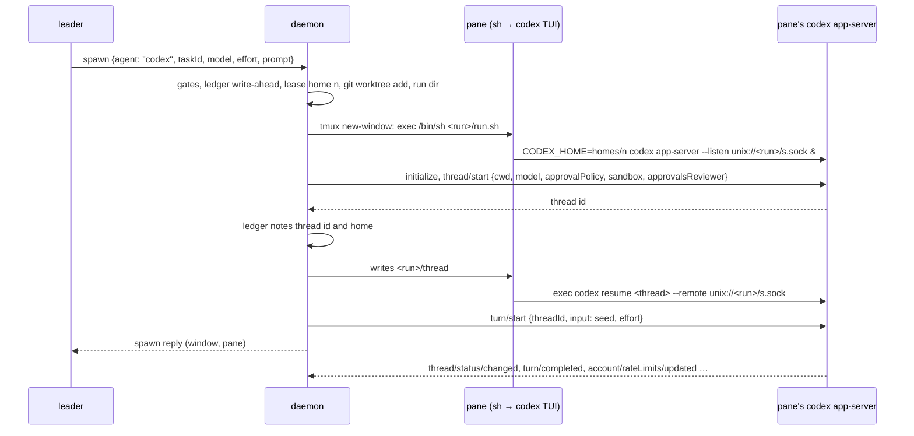

# Codex as a first-class account — design

**Status: design, nothing built.** Written 2026-11-23 from docs/agents.md (the scoping, both Codex spikes of
2026-11-19 on 0.166.0, the owner's decisions of 2026-11-19) and a read of the code at `923bb32`. API names below were
checked against the app-server schema that **codex-cli 0.170.0** generates (`codex app-server generate-json-schema`, read,
not run) and its `--help`; what still needs a live binary is listed under "Spikes". Choices this doc makes are marked
**Decided: X, because Y** for the owner to review; questions only the owner can answer are under "Open questions".

## Goal

A ChatGPT sign-in on a machine is an account the way a Claude login is:

- **named** by an alias any client shows (the `account:` record), else its email;
- **measured**: its 5-hour and weekly windows on the account card, in routing, in the archive;
- **watched**: its login health on the Machines card, a push when it lapses;
- **governed**: closed and reopened (the account hold), pinned to, avoided by the quota line;
- **used**: a task picks a GPT model beside Opus, and the leader places it on a machine whose Codex login has headroom,
  in a tmux pane like any other session.

Not in this design's V1: choosing the agent automatically (a policy question, docs/agents.md "Order" step 3), more than
one Codex account per machine, spending Codex credits, messages into a Codex session, and `agy` (the seams below are
agent-neutral, so it is a second driver, not a second design).

## The shape in one paragraph

The ChatGPT login lives in a store home the daemon owns (`stateDir()/codex/login/`), signed in once per machine by the
owner. A fixed pool of Codex homes shares it by symlink. Identity, quota and login health come over the app-server API
from a short-lived probe, never from the credential file, and reach the wire as a new `MachineInfo.logins` list beside
`exclaves` with its own status fields. A task carries `agent: "codex"` behind a dep sentinel and a capability. Its
session is a tmux pane that hosts **its own** `codex app-server` on a socket in a run dir the daemon made, with the TUI
on that socket as the pane's view, and the daemon as that server's second client. The daemon starts the thread (so it
knows the thread id before anything runs), sends the seed as `turn/start` input (never argv), and reads the session's
state from the server's notifications. Hooks, tools and MCP servers are the pane server's children, so binding by peer
pid holds as it does for Claude.

## Decisions

Carried over from the owner (docs/agents.md, 2026-11-19):

- **Native panes first**; a sidecar server the daemon owns only if panes cannot work, and a dying sidecar must never
  take the daemon down. This design keeps the pane (below).
- **Codex first, then `agy`.**
- **The agent stays explicit** until Codex has a track record on these repos.
- **One `agy` account per machine for V1**, hung off the machine as an agent login, an exclave supplying only the tree.

This doc's:

- **D1. One Codex login per machine, hung off the machine.** _Decided, because_ the owner's `agy` decision rests on
  reasons that hold for Codex (an exclave is 1:1 with a Claude account only to isolate Claude accounts; exclave trees
  are clones of the same repos), and the remote-control pool (D4) is per login. `logins` is a list, so a second login
  later is additive. Open question O1 asks the owner to confirm.
- **D2. The store home is Séance's, not the owner's `~/.codex`.** _Decided, because_ the owner's home may use the
  keyring store (keyed by the home's path, so no other home can share it), runs the owner's auto-start daemon, holds
  the owner's one remote-control slot, and shares one refresh-token chain with the owner's own use. A separate sign-in
  is a separate chain: neither logs the other out. Cost: one device-code sign-in per machine.
- **D3. A pane hosts its own server; the daemon is its second client.** _Decided, because_ it is the one shape that
  answers both of docs/agents.md's risks and its four gaps at once: binding by peer pid holds (everything runs under the
  pane), the thread id comes from the daemon's own `thread/start` (no claimed id), the seed is data, and quota, identity
  and turn state come over a typed API. Rejected shapes are listed at the end.
- **D4. Remote control through a fixed pool of paired homes** (phase 3), per docs/agents.md's verdict: a fresh home
  per pane needs a pairing code typed on the phone each time.
- **D5. Approval policy, sandbox and approvals reviewer come from the machine's own `config.json`**, never a frame.
  _Decided, because_ DESIGN.md's "Autonomy level" holds that no level loosens the machine's permission mode: for a
  Claude session the machine's mode is its `settings.json`, and a Séance home has no owner file to inherit from.
- **D6. Phase 2 runs Codex tasks at `autonomy: "auto"` only.** _Decided, because_ with no phone yet a `checkpoint`
  task that stops on a real choice would sit idle with no alert (below, "Questions read as idle"). Phase 3 opens
  `checkpoint`. Cheap to reverse.

## The account

### Where the login lives

```
stateDir()/codex/                     0700, the daemon's own
  login/                              the store home: CODEX_HOME for `seance codex login` only
    auth.json, auth.lock              written and refreshed by Codex alone
    config.toml                       generated: cli_auth_credentials_store = "file"
  homes/<n>/                          the pool, n = 1..codex.homes
    auth.json -> ../../login/auth.json
    auth.lock -> ../../login/auth.lock
    config.toml                       generated (below)
    sessions/, state_5.sqlite, …      Codex's own: threads, the remote-control enrollment
  probe/                              the reads' home: same links, never a session, never remote control
  homes.json                          the daemon's: which homes are paired (phase 3), 0600
```

- **The links, per spike 2 of docs/agents.md:** a refresh writes through a symlink (0.170 resolves it and renames onto
  the target), the lock is per home so it is linked too, and a refresh reloads from disk first and skips when another
  process already refreshed. A copy is never made: the first refresh of a copy logs every other copy out
  (`refresh_token_reused`).
- **`config.toml` is generated whole** at each daemon start, never edited: file credential store, update checks off,
  `project_doc_fallback_filenames = ["CLAUDE.md"]` so Codex reads the repos' CLAUDE.md files (spike S9),
  `[mcp_servers.seance]` resolved as `daemon/src/link.ts` resolves it for Claude (through `PATH`, never
  `process.execPath`), and no hooks. Approval and sandbox are not in it: they go on each `thread/start` (D5).
- **`config.json` gains a `codex` block**, the machine's own, parsed strictly like `adapters`: `homes` (1–8, default
  2), `approvalPolicy` (`untrusted`, `on-request`, `never`; default `on-request`), `sandbox` (`read-only`,
  `workspace-write`; default `workspace-write`; `danger-full-access` refused), `approvalsReviewer` (`user`,
  `auto_review`; default `user`). No block, no Codex on the machine: no probe runs and `logins` is `[]`.
- **The owner's verbs** (`seance codex login | logout | status`, phase 3 adds `pair | unpair`) are shell acts in the
  one `COMMANDS` table (so a custodian round is denied them by its generated fence), audited under origin `cli`, never a
  frame, local-socket op, broker action, app op or MCP tool. `login` runs `codex login --device-auth` with
  `CODEX_HOME` set to the store home, so it works over SSH; Codex prints the code, Séance prints nothing of it.

### Identity

- **The account id is `codex:<account>:<user>`**: `<account>` is `account/rateLimits/read`'s `accountId` (the backend's
  account, which is the workspace for a Business plan) and `<user>` is `account/read`'s `userId`, both read over the
  probe's API (0.170 has both fields; 0.166's `account/read` had no user id). A Business seat and a personal Plus plan of
  one person are two accounts with two quotas, so the workspace half is needed.
- **Either half null reads as unidentified**: the login shows on the Machines card, carries `accountId: null` and is
  never placed (`auth_missing`, below). _Decided: no fallback to the email, because_ an id that changes shape when a
  field appears would split one account in two in the fleet quota record, the holds and the archive. Spike S1 checks
  both halves on a Business and a Plus login.
- **Disjoint from Claude's ids by construction**: Claude's is `organizationUuid:accountUuid`, never prefixed. Every
  reader holds an account id only to `isAccountId` (a bounded non-empty string), so the `account:` record, its alias and
  rename, pins, holds, the fleet quota record and the archivist's account rows take a Codex account with **no change**.
  `knownAccounts` (`shared/src/account-record.ts`) reads `logins` beside `exclaves`, so `accountName` finds the email.
- **`accountStoreKey`'s HMAC input stays `oauth|` plus the id.** Its comment reserves the namespace for "another kind
  of account id"; _Decided: no new namespace, because_ the id names its own kind, so the inputs are already disjoint,
  and a namespace chosen by kind would make every caller know the kind of an id it holds only as a string. Codex's
  login is OAuth too.
- `email`, `planType` and `workspaceName` are display only, carried in the sealed blob as a Claude exclave's `email` and
  `seatTier` are.

### Quota

- **The source is `account/rateLimits/read`**, no model call (spike 1). Its windows map by `windowDurationMins`, not by
  position: 300 to `h`/`hr`, 10080 to `d`/`dr`. A `rateLimitsByLimitId` bucket naming a `normalModelSlug` with a
  10080-minute window joins `w` under that slug, so `windowAppliesTo` holds it to tasks on that model. Any other
  duration is dropped. `usedPercent` is already an integer; `resetsAt` is taken as unix seconds (spike S6).
- **`s` stays `"cache"`.** _Decided, because_ a new `QuotaSource` would reach the fleet quota record, whose strict
  parser in an older daemon would then read the whole record as unreadable. The value means "the agent's own reading",
  which this is.
- **Credits are not read in V1.** No `c`/`cu`/`cl` for a Codex account, and no spill (O2: a money figure is the owner's
  call).
- **`ordinaryUsageAllowed: false`** (the backend's word that included usage is blocked; its schema says not to infer
  recovery from percentages) puts the login in `lb` (below), which routing filters.
- **Cadence, as the `/usage` refresh's.** A probe runs only for a reading older than `quota.staleAfterMinutes`, on a
  minute timer, never for a signed-out or expired login, and on the usage refresh's one process-wide lane, so a small
  LXC never carries a Claude refresh and a Codex probe at once. While a session runs, the pane server's
  `account/rateLimits/updated` notifications reach the daemon's connection (below) and keep the reading fresh with no
  probe at all.
- **The probe** is a `codex app-server` child on stdio under `CODEX_HOME=<probe home>`: argv array through `exec.ts`,
  `bareEnv` plus `CODEX_HOME`, its own process group, `initialize`, `account/read`, `account/rateLimits/read`, then
  stdin closed; killed by group at 30 s, output capped at 64 KiB, every answer through an exact-shape parser keeping only
  the two id halves, email, plan, workspace name, percents and reset times. Nothing it writes reaches a log; a failure
  warns once per streak with no excerpt (unlike the usage refresh, its output may carry account data).

### Login health

- **From the same `account/read`, never from the store.** The daemon opens no credential file, not even through a child:
  strictly less than Claude's auth health, which has to. `refreshToken` is never set, so Codex refreshes under its own
  rules (within 5 minutes of expiry, or 8 days after the last).
- **States:** signed in and identified (`ok`), `account: null` with `requiresOpenaiAuth` (signed out: `authOk: false`),
  a refresh refused (`refresh_token_reused`, revoked: expired), a probe that failed or has not run (unknown). What
  `account/read` answers on a lapsed login is spike S4. Codex gives no refresh-token expiry, so there is no `expiring`.
- **Alerts** reuse the leader's `authAlertStep`, its `SettingsRecord.authAlerts` entries and the `expired` push text,
  for a login read from `lx`. `AuthAlerted.exclave` holds an exclave id, so a login's entry needs a key no exclave id
  can be that still passes the step's `routable` check and an older leader's parser (an older leader then drops it as
  an exclave gone from the registry, and alerts nothing for it). Choosing that key is a build-time detail.

### On the wire

```ts
/** A non-Claude agent's login on this machine (docs/codex.md, "The account"): one per agent in V1. */
export interface AgentLogin {
  readonly agent: "codex";
  /** `codex:<account>:<user>`; null when signed out or unidentified. Never the email. */
  readonly accountId: string | null;
  readonly email?: string; // display
  readonly plan?: string; // `planType`, display
  readonly workspace?: string; // `workspaceName`, display
  readonly authOk: boolean;
  /** The pool's size: how many Codex sessions this machine runs at once. */
  readonly homes: number;
  /** Homes paired with a phone (phase 3); absent before. */
  readonly paired?: number;
  readonly version?: string; // `codex --version`, display
}

interface MachineInfo {
  // …
  /** Absent from an older daemon (unknown); `[]` when none is configured. */
  readonly logins?: readonly AgentLogin[];
}

interface MachineStatus {
  // …
  /** Quota per login: `x` indexes `MachineInfo.logins`, never `exclaves`. */
  readonly lq?: readonly QuotaObservation[];
  /** Logins whose sign-in has lapsed (`lx`), not yet read or unreadable (`lu`), blocked by the backend (`lb`). */
  readonly lx?: readonly number[];
  readonly lu?: readonly number[];
  readonly lb?: readonly number[];
}
```

- **A list beside `exclaves`, never an entry in it.** An older leader would read a Codex entry as a Claude exclave and
  place Claude tasks on it, and `quota[].x`, `ax` and `sess` index that list.
- `lx`, `lu` and `lb` are never trimmed (as `ax`), disjoint, range-checked against the held blob's `logins` and
  refused past a small bound. `lq` is trimmed with quota detail, before any Claude quota entry. The status budget is
  measured at build time, as `status.test.ts` does for the exclaves.
- A change of identity, `authOk`, `homes` or `paired` re-registers, as a sign-in on a Claude exclave does.

### Routing a Codex task

A candidate is still a (machine, exclave) pair, because the exclave supplies the clone; for a Codex task the account is
the machine's Codex login instead of the exclave's Claude login (`accountOf(machine, exclave, agent)`).

| Reason                                                       | For a Codex task                                                                  |
| ------------------------------------------------------------ | --------------------------------------------------------------------------------- |
| `agent_unsupported` (new)                                    | the machine does not advertise `CAPABILITIES.codex`                               |
| `login_absent` (new)                                         | `logins` is absent or holds no Codex login                                        |
| `auth_missing`, `auth_expired`                               | the login's `authOk`/`accountId`, `lx`; one code per candidate, as for Claude     |
| `login_blocked` (new)                                        | the login is in `lb`                                                              |
| `login_full` (new)                                           | the leader's in-flight Codex tasks placed or reserved there number `homes`        |
| `quota_unknown`, `quota_over_line`                           | on the login account's newest reading, folded across the fleet by account id      |
| `paused`, `pin_mismatch`, `avoided`, traits, machine filters | unchanged: a hold, pin or close names a Codex account id as it names a Claude one |
| `skill_absent`, `model_not_included`, spill                  | not applied: the skill inventory, seats and gated models are Claude's             |

- **Counting by account follows each task's own agent.** `accountInFlight` asks every in-flight task's agent for its
  account, so a running Codex task counts against the Codex account, never the exclave's Claude one. A Claude task's
  candidates never read `logins`, so its routing is unchanged.
- **One account on two machines is one account.** `newestQuotaByAccount` folds `lq` by `logins[x].accountId` beside the
  exclaves' quota; the fleet quota writer folds it the same way, and the archivist's quota series label it by its
  `account:` store key.
- **Estimates:** every Codex plan uses `unknownSeat` (capacity 1) until observed deltas say otherwise.
- All of a machine's exclaves share its login, so their account pressure ties and the existing tie order (device, then
  exclave in code-unit order) decides, reproducibly.

## The task

- **`TaskRequest.agent?: "codex"`**, absent meaning Claude. A parser takes `"claude"` and drops it, so no Claude record
  changes by a byte. `AGENT_KINDS` (`shared/src/tags.ts`) gains `codex`; `agent.kind` already reads from it.
- **`AGENT_DEP_SENTINEL = { task: "", after: "agent" }`**, appended by `taskRecordAtRest` whenever `agent` is set; the
  parser drops it only beside `agent` and nulls the spec over it without, exactly as `TAGS_DEP_SENTINEL`. An older leader
  holds a Codex record unreadable rather than re-seal it without the field and hand it to `claude`.
- **`SpawnRequest.agent?: "codex"`.** An older daemon would drop the field and start Claude, so the leader sends it only
  to a machine advertising `CAPABILITIES.codex` (the route filter), and the PWA's and CLI's direct spawns only to one.
- **`CAPABILITIES.codex`**: as a leader, parses, keeps and routes `TaskSpec.agent`; as a daemon, launches
  `agent: "codex"` and is placed on only while its `logins` holds a signed-in Codex login. Clients write `agent` only to
  a verified leader advertising it. One build does both halves.
- **Model and effort.** `model` stays a free bounded string; a Codex task's default is `DEFAULT_CODEX_MODEL` and the
  clients' list is a constant `CODEX_MODELS` in `shared/` beside the PWA's `MODELS`. _Decided: a constant, not each
  login's `model/list` in the blob, because_ one picker does not justify growing every register. Effort keeps Séance's
  `EFFORTS`; `max` beside `agent: "codex"` is refused (Codex has no `max`; mapping it silently to `xhigh` would run
  something nobody asked for). The record always says `agent` explicitly; no reader infers it from a model name.
- **Refused beside `agent: "codex"` in V1:** effort `max`, `steer`/`plan` (no plan mode reaches the app-server's
  `turn/start` in 0.170, and only a tightening may stand in), any level but `auto` in phase 2 (D6), `attachments`,
  `continues` and `succeeds` (phase 3). Clients refuse them before a write (`specError` in `daemon/src/auto.ts` for
  MCP, the broker and the CLI; the PWA's form). A record that carries one anyway stays readable and the leader places
  it nowhere (`agent_unsupported` on every candidate), so a later build that supports it can run it. `until`, deps,
  batches, tags and `pin`/`avoid` are agent-neutral and pass.

## The session

### A pane that hosts its own server



1. **Gates and ledger as today**: the closed gate, `relaunchRefusal`, the launch ledger's write-ahead record of the task
   id. A home is leased from the pool (an in-memory table rebuilt at start from live panes) and noted with the launch.
2. **The worktree is the daemon's own `git worktree add`**, at `.claude/worktrees/<slug>` on `worktree-<slug>` from
   `origin/<default>`, as `addStackedWorktree` already does for a stack. _Decided: the Claude path, because_ reap, the
   custodian's worktree removal, continue and `pushTaskBranch` all find a task's worktree there; a second layout would
   be a second rule in each.
3. **The run dir** is `/tmp/seance-cx-<mkdtemp>` (0700, checked with `lstat`; under `/tmp`, never `tmpdir()`, for the
   104-byte socket path on macOS, as the custodian's is), holding `run.sh`, `s.sock` and `thread`.
4. **The pane runs `exec /bin/sh '<run>/run.sh'`** (the custodian's pattern: the owner's tmux `default-shell` parses no
   quoting of it), wrapped in `caffeinate -is` on macOS. The script is constant text with daemon paths through `shq()`:
   start the server in the background, wait (bounded) for `thread`, then `exec` the TUI on that thread. The server is
   the shell's child, so after the `exec` it is the TUI's: the pane pid is the TUI, and every hook, tool command and MCP
   server is a descendant of it. The window carries `SEANCE_AUTONOMY` and the machine tag like any session.
5. **The daemon dials `s.sock`** (WebSocket over the unix socket, as spike 1 found), checks the server's
   `initialize` answer and version, and calls `thread/start` with `cwd` its own worktree path, `model` from the parsed
   spec, approval, sandbox and reviewer from `config.json` (D5). The returned thread id is noted in the launch ledger
   as `session`, before any turn: the continue invariant then reads "the thread id this daemon's own `thread/start`
   returned", never a claimed one.
6. **The seed is `turn/start` input**: the preamble, the autonomy note and the task, as text, never argv, never a file
   the model reads. The preamble is agent-aware ("a new independent Codex session", "AGENTS.md or CLAUDE.md"), and
   Codex's autonomy note says to stop on a real choice by ending the turn with the question stated (it has no
   `AskUserQuestion`).
   `developerInstructions` carries nothing in V1: the standing instruction is about the inbox, which a Codex session
   does not have yet.

**If the TUI cannot attach to a thread another client started (spike S2)**, the script runs the server in the
foreground instead (`exec codex app-server …`): the pane shows no TUI, a person looks in with
`codex resume <thread> --remote unix://<run>/s.sock` (which `seance` prints), and nothing else here changes.

### State: the server's notifications, into the existing pipeline

| Server says                                  | Session event                       |
| -------------------------------------------- | ----------------------------------- |
| `thread/status/changed` → `active`, no flags | `busy`                              |
| → `active` with `waitingOnApproval`          | `needs-input`, `reason: permission` |
| → `active` with `waitingOnUserInput`         | `needs-input`, `reason: question`   |
| `turn/completed`, then `idle`                | `idle`, `turnEnded`                 |
| → `systemError`                              | `idle` (no `turnEnded`)             |
| `thread/closed`, or the pane gone            | `ended`                             |

- **Bound by construction, never by a field.** The daemon launched the pane and made the socket, so it knows pane, pid,
  task and thread; a notification naming another thread id is dropped. Each event enters the same internal step a bound
  local-socket frame reaches after binding, so the leader forwarding, the idle release, the hand-off and pass closes,
  the needs-input alerts, the conversation table and pane activity downstream are unchanged. `agent` is
  `{kind: "codex", session: <thread id>}`, verified at the source.
- **This is a new source of session events, not a new act.** It sends nothing to a session and acts on nothing the
  notification names. It is the one place a non-hook source feeds the pipeline, recorded in DESIGN.md beside
  "Session events" when built.
- **Hooks: none in V1.** _Rejected for V1:_ `seance session-event --hook` from a generated `hooks.json` — each hook
  needs a trust hash Séance would compute against Codex internals (`[hooks.state…] trusted_hash`), costs a process per
  event, and says nothing the notifications do not.
- **A daemon restart reconnects** to every live Codex pane's socket (its run dir is noted beside the launch) and reads
  `thread/read` to resync. A lost connection is no session end; a pane death is.
- **Not in V1:** `stop` notes (background work), `tool` on a permission wait (the approval request carries it; display
  only, later).
- **Questions read as idle.** In Codex's default mode a question is prose, so it reads as an idle turn end, as with
  `agy`: no alert. That is D6's reason.
- **The daemon never answers an approval request** it receives as a client: it is no session UI and never grants. Who
  receives one, and whether an unanswered copy at the daemon holds a turn, is spike S3.

### Tools

`seance mcp` is registered in every home's `config.toml`, so it runs as a child of the pane's server and binds by peer
pid with no change: `report_task_done`, `hand_off_task`, `pass_to_successor` (phase 3) and `send_message` out. The
binding's session rule (`sessionOf`: the innermost process on the peer's chain called `claude`) learns the pane's
agent: for a Codex pane, the innermost `codex`, which is the pane's server. Watches need an inbox listener, so a Codex
session's `watch_github` is refused `nolistener` until messages land.

### Close, despawn and the rest

- **Graceful close** is the driver's: `turn/interrupt` over the connection while a turn runs, then the window is
  killed; the thread stays in its home's store. Every despawn, reap and harvest path audits under its own origin as
  today, the line gaining `agent=codex`.
- **Reap** is unchanged (the worktree is where it looks). A home's `sessions/` grows like a Claude config dir's
  `projects/`; pruning it is later.
- **The custodian** sees a Codex pane as `ours`, reads its state from the events above, and may `close` and `capture`
  it. `nudge` (an inbox) and `interrupt` (an Escape key) answer `unsupported` for a Codex pane until phase 3 gives them
  `turn/steer` and `turn/interrupt`.
- **A closed machine** lets its Codex tasks finish in place: the drain ask types keys into a Claude pane, and the outside
  pass makes a successor, both phase 3 for Codex (`EndedTasks.askable` is false for a Codex launch).
- **A dying server** is one closed connection and one ended session. The daemon parses every message strictly, bounds
  its size, and never lets a socket error escape as an exception: the owner's "shed it and keep running", per pane.

### Remote control and the pool (phase 3)

- **A home's server enables remote control over the daemon's connection** (`remoteControl/enable`) once that home is
  paired, reusing the home's persisted enrollment (docs/agents.md, spike 2, item 5; spike S5 confirms it on a `--listen`
  server). An unpaired home still takes tasks, without a phone.
- **`seance codex pair <n>`** starts a server on home `n` when no pane holds it, asks `remoteControl/pairing/start`
  with `manualCode: true` (0.170 also ships `codex remote-control pair`), prints the code, waits for a new client in
  `remoteControl/client/list`, and records the pairing in `homes.json`. `unpair` revokes the client
  (`remoteControl/client/revoke`; `disable` would leave an offline entry). Every entry reads as the hostname; the phone
  tells panes apart by project (cwd) and thread.
- **Leasing** prefers a paired home for a task that may need a person and an unpaired one for `auto`.
- **`agent.remote`**: a link into the ChatGPT app for a thread, if one exists (spike S7); without it the PWA links
  nothing for a Codex task.

### Parity (phase 3)

- **Continue** resumes the noted thread in the noted home (`thread/resume` takes a `threadId` only in 0.170, so a
  thread lives in its home's store), under the same rules as `mode: "continue"` today: sealed from the scheduler, the
  worktree and thread from this machine's own ledger, never a frame. The home being leased is a transient refusal the
  leader retries.
- **Pass to a successor**, the quota trigger and the drain: the push and the record are agent-neutral; the close is the
  driver's; a successor inherits `agent` and is never placed on another agent.
- **The drain ask and the custodian's `interrupt`** send `turn/interrupt` and the constant `DRAIN_PROMPT` as a turn over
  the connection, never keys: pasting into Codex's composer and pressing Enter at once wedges it (openai/codex#28167).
- **Messages into a Codex session** would arrive as `turn/steer` (busy) or `turn/start` (idle), so as user turns, in
  Séance's fixed wrappers. That differs from the inbox mod's rule (never `asUser`), so it waits for the owner (O4).

## Threat model changes

To land in DESIGN.md's threat model and CLAUDE.md's invariants with the code that makes them true:

1. **A second credential store**: `stateDir()/codex/login/auth.json`, a ChatGPT refresh token. Codex alone writes and
   refreshes it. The daemon makes symlinks to it in its own homes and never opens, reads, copies or backs it up; any
   other copy is a bug, since the first refresh of a copy logs out the rest. `stateDir()` is already in the custodian's
   masks. A backup restoring an older copy logs the machine out: accepted, the owner signs in again.
2. **Identity, quota and login health come over the API, never from the store**: the daemon holds no ChatGPT token,
   not even through a child. The probe's exec rules are "Quota" above; nothing of its output is logged.
3. **A second binary**: `codex` resolved through `PATH` at each use, never persisted; `--version` for display; update
   checks off in every generated `config.toml`, and no auto-start daemon (a `--listen` server is not one; spike S5).
4. **The pane server's socket** lives in a 0700 run dir the daemon made and `lstat`-checks before dialing; the daemon
   dials only the socket of a pane it launched. Any same-uid process can dial it too, as it can drive tmux: the
   boundary is unchanged.
5. **What the daemon sends a server**: constant method names; `cwd` its own path; approval, sandbox and reviewer from
   `config.json` only; `model` and `effort` from the parsed spec; the seed as data; `turn/interrupt`. No other frame
   field reaches a param, and nothing reaches argv but daemon paths and the thread id, through `shq()`.
6. **What the daemon keeps from a server**: thread status and ids, turn lifecycle, rate-limit numbers, after an
   exact-shape parse. Never model text (`item/completed`, an agent message) in a log, an audit line or a frame. The
   daemon never answers an approval request.
7. **The task field** `agent`: sealed through the one task sealer behind `AGENT_DEP_SENTINEL`, written by a client only
   to a verified leader advertising `CAPABILITIES.codex`, sent in a spawn only to a machine advertising it.
8. **The launch ledger** notes a Codex launch's thread id and home, and a continuation resumes only those.
9. **Pairing** (phase 3) is the owner's shell act; a paired phone drives sessions in that home through OpenAI's
   remote control, as the Claude app does through Anthropic's.
10. **Audit**: spawn and despawn lines gain `agent=codex`; a probe carries no origin (it is not a spawn, as the usage
    refresh is not); `seance codex login | logout | pair | unpair` audit under `cli` with a home number and outcome,
    never a code, an email or an id.

## Rejected alternatives

- **The login as an entry in `exclaves`.** An older leader would place Claude tasks on it; `quota[].x`, `ax` and `sess`
  index that list; seats would misread it.
- **A Codex home per exclave** (a Codex account per exclave). Against the owner's one-account V1 decision, and each
  exclave would need its own paired pool. `logins` keeps the door open.
- **The owner's `~/.codex` as the store.** D2.
- **One daemon-owned server per account, no panes** (docs/agents.md's candidate). Its tools and MCP servers are children
  of one server, so `report_task_done`, `hand_off_task` and `pass_to_successor` could bind only by a claimed session id,
  a threat-model change; one server is one failure domain for every session on the account; and the owner prefers
  panes.
- **`codex --no-daemon` alone in the pane.** Binding holds, but the seed is argv only and the session id is learned
  from the first hook's claim; no remote control.
- **`codex exec`.** No phone and no live state, and thrown away at parity; the pane server gives the same headless run.
- **Reading `auth.json` for the account id** through auth health's child. `account/read` and `account/rateLimits/read`
  give both halves with no credential read.
- **A `QuotaSource` of its own.** The fleet quota record would read as unreadable to an older daemon.
- **Inferring the agent from the model name.** A model string never chooses what runs.

## Build order

Each is one PR, with DESIGN.md, CLAUDE.md and the docs it touches in the same commit.

**Phase 1: the account.** No Codex task runs, but the ChatGPT account is named, measured and watched.

1. **Daemon:** the `codex` config block, the homes layout and generated config, `seance codex login | logout | status`,
   the probe, `MachineInfo.logins`, `MachineStatus.lq`/`lx`/`lu`/`lb` with their parsers and the status budget.
2. **Readers:** `newestQuotaByAccount` and the fleet quota writer fold `lq`; the PWA's account card (an agent badge,
   the windows, rename, the "Open for work" switch through the existing account hold) and the Machines card's login
   row; MCP `list_machines`; the archivist's quota series; the leader's login alert.

**Phase 2: auto tasks run.** Spikes S1–S4, S6, S8 and S9 first.

3. **The field:** `TaskRequest.agent`, `AGENT_DEP_SENTINEL`, `CAPABILITIES.codex`'s leader half, the route filters and
   account-by-agent counting, the `specError` refusals. Nothing places a Codex task yet: no daemon launches one.
4. **The driver seam, no behaviour change:** Claude's argv, pane recognition, graceful close, trust and resume move
   behind an `AgentDriver` interface (`daemon/src/agents/claude.ts`), the command line byte-identical under test.
   (Named driver, not adapter: "adapter" is messaging's.)
5. **The Codex driver:** leases, the run dir and script, the connection, `thread/start`, the ledger's thread and home,
   the seed, notifications into the pipeline, the graceful close, reconnect at start, pane recognition; the daemon
   advertises `codex` while a login is configured.
6. **Clients:** the PWA's model picker grouped by agent (picking a GPT model sets `agent`), effort per agent, an agent
   badge on the Queue; MCP `spawn_session` and `queue_batch` take `agent`; `seance spawn --agent codex`.

**Phase 3: parity.** Spikes S5 and S7 first.

7. Remote control: pairing verbs, `paired`, leasing by pairing, `agent.remote` if S7 finds a link; opens `checkpoint`.
8. Continue in the noted home.
9. Pass to a successor, the quota trigger, the drain ask and the custodian's `interrupt` over the connection.
10. Messages into a Codex session, once O4 is decided.

**Phase 4:** the leader's `auto` choosing the agent as well as the account, a policy the owner sets.

## Spikes

On the Codex version that ships, before the phase that needs each. 0.170.0's schema already answered three of
docs/agents.md's open questions in part: `account/read` has `userId`, thread status carries `waitingOnApproval` and
`waitingOnUserInput` flags whoever started the turn, and `thread/start` takes `approvalsReviewer` (`user`,
`auto_review`).

- **S1. Identity.** `account/read`'s `userId` and `account/rateLimits/read`'s `accountId` present and stable for a
  Business and a Plus login, and equal on two machines signed into one account.
- **S2. The TUI attaches.** `codex resume <id> --remote unix://…` shows a thread the daemon started, its running turn
  and its approvals, and a phone turn shows in it.
- **S3. Notifications and approvals across clients.** `thread/status/changed` and `turn/completed` reach the daemon's
  connection for turns the TUI or the phone started; which clients receive an approval request, and whether one left
  unanswered at the daemon holds the turn.
- **S4. A lapsed login.** What `account/read` answers after `refresh_token_reused`, after a revoke, and signed out.
- **S5. Remote control on a `--listen` server.** `remoteControl/enable` reuses the home's enrollment and pairing; no
  auto-start daemon and no self-update under the generated config; the socket stays where `--listen` put it.
- **S6. Quota on a fresh probe.** `account/rateLimits/read` from a fresh stdio server returns current windows (a fetch,
  not this process's cache); `windowDurationMins` 300 and 10080; `resetsAt` in unix seconds.
- **S7. A link to a thread** in the ChatGPT app, for `agent.remote`.
- **S8. Platforms.** On macOS, the file store in a Séance home and `codex login --device-auth`; on Linux in an LXC, the
  bwrap sandbox under `workspace-write`.
- **S9. Project docs.** `project_doc_fallback_filenames = ["CLAUDE.md"]` makes Codex read a repo's CLAUDE.md files.

## Open questions

For the owner:

- **O1.** One Codex login per machine (D1), as for `agy`? _Recommend yes._
- **O2.** Codex credits: show the balance on the account card, and spill into it past the quota line? A money figure, so
  V1 does neither. _Recommend neither until Codex has a track record._
- **O3.** The pool's default size (2) and whether an unpaired home takes tasks. _Recommend 2, and yes for `auto`._
- **O4.** Messages into a Codex session arrive as user turns (`turn/steer`, `turn/start`) in Séance's wrappers, where
  Claude's inbox never uses `asUser`. Acceptable? _Recommend yes, behind the same binding and rate limits, with the
  standing instruction telling the session what a message is._
- **O5.** Unattended approvals. `on-request` stalls an `auto` task at its first escalation until someone answers;
  `approvalsReviewer: "auto_review"` (a reviewing subagent) or `approvalPolicy: "never"` are the machine's own choice in
  `config.json`. _Recommend `auto_review` on machines that run Codex unattended, after S3._

At build time:

- `lq`'s place in `fitStatus`'s trim order, and the bound on `lx`/`lu`/`lb`, measured against `STATUS_MAX_CT_LENGTH`.
- `DEFAULT_CODEX_MODEL` and `CODEX_MODELS`, from `model/list` on the shipping version.
- A WebSocket client over a unix socket in Bun, or a minimal one over `Bun.connect({ unix })`.
- Recognising a Codex pane in `sessions.ts`: its start command names a run dir under `/tmp/seance-cx-`, beside the
  window's `@seance-task`.

## Where it lands

| Part                                                                                            | Where                                                                          |
| ----------------------------------------------------------------------------------------------- | ------------------------------------------------------------------------------ |
| `AgentLogin`, `logins`, `lq`/`lx`/`lu`/`lb`, `agent`, the sentinel, the capability, the reasons | `shared/src/types.ts`, its parsers in `shared/src/parse.ts`                    |
| `AGENT_KINDS`                                                                                   | `shared/src/tags.ts`                                                           |
| Quota folding, login health reader                                                              | `shared/src/quota.ts`, `shared/src/status-reader.ts`                           |
| Routing by agent                                                                                | `scheduler/src/route.ts`                                                       |
| Homes, generated config, probe, verbs                                                           | `daemon/src/codex/` (`homes.ts`, `probe.ts`, `codex-cli.ts`)                   |
| The connection and the driver                                                                   | `daemon/src/codex/client.ts`, `daemon/src/agents/codex.ts`                     |
| The seam                                                                                        | `daemon/src/agents/driver.ts`, `daemon/src/agents/claude.ts`                   |
| Clients                                                                                         | `pwa/src/` (picker, account card, Machines row), `daemon/src/mcp*.ts`, the CLI |
